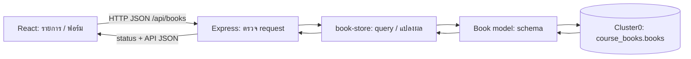

# แบบจำลองข้อมูลร้านหนังสือ: จากหน้าจอถึง MongoDB

ใช้คู่กับ [Lab 10](../labs/10-book-database-crud.md) และ [starter](../examples/10-mongodb-book-api/README.md)

## เริ่มจากสิ่งที่ผู้ใช้ทำ

ผู้ใช้เปิดรายการหนังสือ → เลือกดูหนึ่งเล่ม → เพิ่มแหล่งอ่านใหม่ → เปิดแอปวันถัดไปแล้วยังพบเล่มนั้น เราจึงต้องมีข้อมูล **Book** ที่อยู่ได้นานกว่า process ของ Express สำหรับ Course Book Explorer คำว่า book ครอบคลุมหนังสือ เอกสาร และรายวิชา ตาม `sourceType`



React ไม่รู้รหัสผ่าน MongoDB และไม่สร้าง connection ไป Atlas Express อ่าน `.env` บน server เท่านั้น Schema บอกโครงสร้างข้อมูล; store สั่งอ่าน/เขียน; routes แปล HTTP เป็นคำสั่งของแอป ไม่ควรปะปนสามหน้าที่ไว้ใน React

## Cluster0, database และ collection คืออะไร

```text
Atlas project ของคุณ
└── Cluster0                      บริการ MongoDB ของคุณ
    └── course_books              database ของแอป
        └── books                 collection ของ Book
            ├── document เล่มที่หนึ่ง
            └── document เล่มที่สอง
```

ทุกคนตั้งชื่อ Cluster0 เหมือนกันได้ แต่ endpoint และบัญชีเป็นของแต่ละคน `mongoose.model('Book', bookSchema)` ใน starter ใช้ collection `books` ตามการตั้งชื่อปริยายของ Mongoose ตัวพิมพ์และชื่อฐานต้องตรงกับ URI และหน้าที่เปิดใน Atlas

## ข้อมูลเล่มเดียวกันในสามชั้น

**1. React ส่ง POST body** มีเฉพาะข้อมูลที่ผู้ใช้กรอก:

```json
{
  "title": "Database Practice",
  "author": "Mali",
  "sourceType": "course",
  "summary": "สรุปจากการทดลองของฉัน"
}
```

**2. MongoDB เก็บ document** ตัวอย่างต่อไปนี้ใช้รูปแบบที่อ่านง่ายแบบ mongosh ค่า ID/date เป็นเพียงตัวอย่าง:

```js
{
  _id: ObjectId("674000000000000000000001"),
  title: "Database Practice",
  author: "Mali",
  sourceType: "course",
  summary: "สรุปจากการทดลองของฉัน",
  titleKey: "database practice",
  createdAt: ISODate("2026-11-17T09:00:00Z"),
  updatedAt: ISODate("2026-11-17T09:00:00Z")
}
```

MongoDB สร้าง `_id`; server สร้าง `titleKey`; Mongoose สร้าง timestamps อาจเห็น `__v` ซึ่งเป็น field ภายใน Mongoose ด้วย อย่าพิมพ์ ObjectId ตัวอย่างนี้ทับ ID จริงของหนังสือ

**3. Express ตอบ API JSON**:

```json
{
  "data": {
    "id": "674000000000000000000001",
    "title": "Database Practice",
    "author": "Mali",
    "sourceType": "course",
    "summary": "สรุปจากการทดลองของฉัน"
  }
}
```

ID เป็น string ที่ React ใช้กับ key และ URL ของ detail ส่วน `titleKey`/`__v` ไม่ส่งออก GET list ใช้ `data` เป็น array; GET detail และ POST ใช้ `data` เป็น object หน้าเดิมจึงยังอ่านรูปแบบ response เดิมได้

## จาก model สู่โค้ดในแอป

เปิดไฟล์ใน `examples/10-mongodb-book-api/` ตามลำดับนี้ กิจกรรมให้คุณเขียนฟังก์ชัน store และ routes เองตามสัญญาที่ระบุ:

| ชั้น/ไฟล์ | สิ่งที่รับ | งานที่ต้องทำ | สิ่งที่คืน |
|---|---|---|---|
| `src/models/Book.js` | field ตาม schema | กำหนดชนิด/required/enum, timestamps, index | Mongoose model ที่ query ได้ |
| `src/book-store.js`: list | limit/offset ที่ตรวจแล้ว | find → sort → skip → limit → await → แปลงแต่ละ document | array ของ API book |
| store: find | ObjectId string ที่ตรวจรูปแล้ว | findById → await → แปลงถ้าพบ | API book หรือ null |
| store: insert | สี่ field ที่ตรวจแล้ว | สร้าง titleKey → create → await → แปลงผล | API book ใหม่ |
| `src/server.js`: GET | path/query | ตรวจพารามิเตอร์ → await store → เลือก status | 200 / 422 / 404 |
| server: POST | request body | ตรวจ field → await store → ตั้ง Location | 201 / 422 / 409 |
| server: error middleware | ข้อผิดพลาด | แปลง duplicate/DB error, ใส่ request ID | problem JSON ที่ไม่เผยข้อมูลภายใน |
| React API service | API JSON | อ่าน data → อัปเดต state → render | รายการ/รายละเอียด/ข้อความ error |

ตัวอย่าง query ที่ใช้ประกอบการเติมฟังก์ชัน (ไม่ใช่ route สำเร็จรูป):

```js
// Book คือ model ที่ import จาก ./models/Book.js
const documents = await Book.find().sort({ _id: 1 }).skip(offset).limit(limit);
// งานของคุณ: แปลง documents เป็น array ของ API book ก่อนคืนให้ route
```

`offset` หมายถึงจำนวนเล่มที่ข้ามจากต้นผลลัพธ์ `limit` หมายถึงจำนวนเล่มสูงสุดในหน้านั้น ตัวอย่าง offset 2, limit 2 คือข้ามสองเล่มแรกแล้วเอาสองเล่มถัดไป ไม่ใช่ค้นหา id=2

เมื่อ POST ครั้งแรกได้ id จริง ให้ลอง GET `/api/books/<idจริง>` แล้ว restart Express ถ้า record อยู่ใน Atlas และ GET ยังพบ แสดงว่า request วิ่งผ่าน store/model ไปเก็บฐานข้อมูลแล้ว การที่ React ยังแสดงจาก state โดยไม่โหลดใหม่ไม่ใช่หลักฐาน persistence

## ข้อจำกัดที่ต้องเข้าใจ

- `titleKey` ทำให้ชื่อที่ต่างเฉพาะตัวพิมพ์ใหญ่เล็ก/ช่องว่างหัวท้ายชนกัน ภายในแลบนี้ถือว่าซ้ำ ส่วนชื่อเดียวกันคนละฉบับอาจเป็นคนละเล่มจริง จึงต้องออกแบบเพิ่มหากใช้เป็นร้านจริง
- validation ใน route ให้ feedback ที่เหมาะกับ HTTP ส่วน schema ช่วยกันข้อมูลผิดจากโค้ดที่เขียนผ่าน model โดยตรง และ unique index ป้องกันข้อมูลซ้ำแม้สองคำขอมาพร้อมกัน
- ObjectId มีไว้ระบุ record ไม่ใช่หลักฐานสิทธิ์การเข้าถึง Lab 10 ยังไม่มีบัญชีลูกค้าหรือข้อมูลส่วนตัว; เพิ่ม authentication/authorization ตาม Lab 11 ก่อนเปิดฟังก์ชันส่วนบุคคล
- ใช้ summary ที่เขียนเอง ไม่เก็บเนื้อหาหนังสือที่มีลิขสิทธิ์ทั้งเล่ม

## หากจะขยายเป็นร้านขายหนังสือจริง (งานต่อยอด)

**ยังไม่ต้องเพิ่มส่วนนี้เพื่อผ่าน Lab 10** schema และ POST ปัจจุบันรองรับเฉพาะ metadata สี่ field ด้านบน ออกแบบ data dictionary, เปลี่ยน validation/model/API/UI และเพิ่มการทดสอบก่อนเริ่มเขียนข้อมูลชนิดใหม่

| สิ่งที่ผู้ใช้ต้องทำ | ข้อมูลที่อาจเพิ่ม | เหตุผล/ข้อจำกัด |
|---|---|---|
| ดูราคาหนังสือ | `priceSatang`: integer >=0, `currency`: THB | เก็บหน่วยสตางค์ เช่น 25900 = 259 บาท ลดปัญหาเลขทศนิยม |
| ดูจำนวนที่ขายได้ | `stock`: integer >=0 | ต้องลด stock ด้วยการเขียนแบบ atomic และเงื่อนไขจำนวนพอ ไม่อ่านแล้วเขียนทับจาก client |
| แยกฉบับพิมพ์ | ISBN/edition ตามข้อมูลจริง | เปลี่ยนนโยบาย unique title ให้ตรงธุรกิจ; ต้องวางแผน migration/index ก่อน |
| ลูกค้าสั่งหลายเล่ม | collection `orders`; ฝัง items array | แต่ละ item อ้าง bookId และเก็บ snapshot ชื่อ/ราคาตอนสั่ง เพราะข้อมูล book เปลี่ยนภายหลังได้ |
| จดบันทึกการอ่าน | collection `reading_notes` อ้าง bookId และ ownerId | แยกเพราะอาจมีหลายบันทึกต่อเล่ม และต้องตรวจสิทธิ์เจ้าของทุกครั้ง |

ความสัมพันธ์ที่เสนอ: Book หนึ่งเล่มถูกอ้างได้จาก OrderItem หลายรายการ; Order หนึ่งใบมี OrderItem หลายรายการ ไม่เอารายการสั่งซื้อทั้งหมดไปฝังใน Book เพราะโตไม่จำกัด และอย่าเชื่อยอดเงิน/ownerId ที่ client ส่ง ต้องคำนวณราคาและตรวจสิทธิ์บน server พร้อมทดสอบกรณีถูกปฏิเสธด้วย

อ้างอิง: [MongoDB data modeling](https://www.mongodb.com/docs/manual/data-modeling/), [Mongoose models](https://mongoosejs.com/docs/models.html), [unique indexes](https://www.mongodb.com/docs/manual/core/index-unique/)
