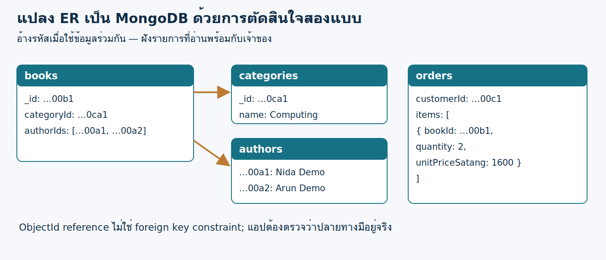
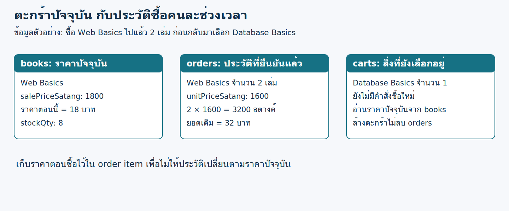

# ช่วง 3 — อ่าน ER ร้านหนังสือทั้งสามภาพ แล้วดูข้อมูล MongoDB ที่ตรงกัน

[กลับหน้า Lab 10](../labs/10-book-database-crud.md) · ก่อนหน้า: [ตัวอย่างเครื่องดื่ม](lab10/02-drinks-walkthrough.md) · ถัดไป: [Book API](lab10/03-book-api-walkthrough.md)

ใช้ข้อมูลที่ `npm run demo:seed` ใส่ไว้ใน `course_books_demo` เปิด Data Explorer ไว้เพื่อดู document ควบคู่กับความสัมพันธ์ใน ER

## 3.1 เริ่มจากเรื่องเล่าของลูกค้าหนึ่งคน


ลูกค้าสมมติชื่อ Mali Demo เคยซื้อ **Web Basics 2 เล่ม** ตอนราคาเล่มละ **16 บาท** จึงมีประวัติคำสั่งซื้อยอด **32 บาท** ปัจจุบัน Web Basics ขายราคา **18 บาท** และมีคงเหลือ **8 เล่ม** ต่อมา Mali กลับมาเลือก **Database Basics 1 เล่ม** ไว้ในตะกร้า ยังไม่ได้ยืนยันซื้อรอบใหม่

เหตุการณ์เดียวนี้แสดงให้เห็นว่าต้องแยก **ข้อมูลหนังสือปัจจุบัน**, **ตะกร้าที่เปลี่ยนได้**, และ **ประวัติที่ยืนยันแล้ว** ราคาปัจจุบันเปลี่ยนได้ แต่ยอดที่เคยจ่ายไม่ควรเปลี่ยนตาม

ตัวเลขทั้งหมดเป็นข้อมูลสมมติในไฟล์ `demo/data.js` ไม่มีการตัดเงินจริง และสคริปต์ seed ไม่ได้จำลองการซื้อทีละขั้น มันเตรียมสถานะตัวอย่างหลังเหตุการณ์ไว้ให้เปิดอ่านได้ทันที

## 3.2 ภาพ 1: แบบจำลองระดับแนวคิด บอกว่าเราสนใจสิ่งใด


เริ่มมองกล่อง ไม่ต้องอ่านทุกเส้นพร้อมกัน กล่องแต่ละใบเป็น **entity** หรือสิ่งที่เราต้องเก็บข้อมูล เช่น ลูกค้า หนังสือ และคำสั่งซื้อ เส้นบอกว่าสิ่งเหล่านั้นเกี่ยวกันอย่างไร

ตัวเลขใกล้ปลายเส้นบอกจำนวนของ entity ที่ปลายด้านนั้น ต่อ entity หนึ่งรายการที่อีกด้าน:

| สัญลักษณ์ | อ่านว่า | ตัวอย่างจากภาพ |
|---|---|---|
| `1` | หนึ่งพอดี | คำสั่งซื้อหนึ่งใบเป็นของลูกค้าหนึ่งคน |
| `0..1` | ไม่มีหรือมีหนึ่ง | ลูกค้าหนึ่งคนอาจยังไม่มีตะกร้า หรือมีตะกร้าหนึ่งใบ |
| `0..*` | ไม่มีหรือมีหลาย | ลูกค้าหนึ่งคนอาจยังไม่เคยซื้อ หรือมีหลายคำสั่งซื้อ |
| `1..*` | อย่างน้อยหนึ่ง | คำสั่งซื้อที่ยืนยันแล้วต้องมีหนังสืออย่างน้อยหนึ่งรายการ |

เดินตามเรื่อง Mali ทีละเส้น:

1. **ลูกค้า → คำสั่งซื้อ:** Mali มีประวัติหนึ่งใบ ในอนาคตอาจมีหลายใบ แต่แต่ละใบอ้างลูกค้าคนเดียว
2. **ลูกค้า → ตะกร้า:** Mali มีตะกร้าหนึ่งใบไว้เลือกสินค้าเพิ่มได้ ตะกร้าไม่ใช่คำสั่งซื้อ
3. **ตะกร้า ↔ หนังสือ:** ตะกร้าหนึ่งใบมีหลายชนิดหนังสือได้ และหนังสือชนิดเดียวอยู่ในตะกร้าของลูกค้าหลายคนได้
4. **หมวดหมู่ → หนังสือ:** ตัวอย่างกำหนดหมวดหลักหนึ่งหมวดต่อรายการขาย หมวด Computing มีหนังสือสองเล่ม
5. **ผู้เขียน ↔ หนังสือ:** หนังสือหนึ่งเล่มมีผู้เขียนร่วมหลายคนได้ และผู้เขียนคนหนึ่งมีหลายเล่มได้

แบบจำลองระดับแนวคิดระบุสิ่งที่ต้องเก็บและความสัมพันธ์ โดยยังไม่กำหนดชนิดข้อมูลหรือวิธีจัดเก็บของฐานข้อมูลใด

## 3.3 ภาพ 2: ระดับตรรกะ แยกสิ่งที่ต้องเก็บให้ชัด


ภาพนี้ใช้แนวทางตารางเชิงสัมพันธ์ จึงมี **9 ตาราง** คำว่า **PK** คือคีย์หลักใช้ระบุแถว **FK** คือคีย์นอกที่อ้างแถวอีกตาราง **UQ** คือค่าที่ต้องไม่ซ้ำ

| ตาราง | เก็บข้อมูลอะไร | ตัวอย่างในเรื่อง Mali |
|---|---|---|
| CUSTOMER | ลูกค้า | Mali Demo |
| CART | ตะกร้าของลูกค้า | ตะกร้าปัจจุบันของ Mali |
| CART_ITEM | หนังสือแต่ละชนิดในตะกร้าและจำนวน | Database Basics จำนวน 1 |
| SALES_ORDER | หัวคำสั่งซื้อที่ยืนยัน | คำสั่งซื้อเดิมของ Mali |
| ORDER_ITEM | สินค้า จำนวน และราคาตอนซื้อ | Web Basics จำนวน 2 ราคาตอนซื้อ 16 บาท |
| BOOK | รายการขายหนังสือ | Web Basics และ Database Basics |
| CATEGORY | หมวดหลัก | Computing |
| AUTHOR | ผู้เขียน | Nida Demo, Arun Demo |
| BOOK_AUTHOR | คู่หนังสือ–ผู้เขียน | Web Basics เชื่อมผู้เขียนสองคน |

ทำไม CART_ITEM ไม่เป็นแค่รายชื่อหนังสือ? เพราะต้องเก็บ **quantity ของการเลือกครั้งนั้น** ด้วย หนังสือเดียวกันอยู่คนละตะกร้าอาจมีจำนวนต่างกัน คีย์คู่ `(cart_id, book_id)` ช่วยระบุรายการเฉพาะในตะกร้านั้น

ทำไมมี ORDER_ITEM แยกจาก CART_ITEM? เพราะล้างตะกร้าหรือเลือกสินค้าใหม่ได้ แต่ประวัติซื้อยังต้องอยู่ ORDER_ITEM จึงเก็บจำนวนและราคาที่ตกลงตอนซื้อ ไม่อิงราคาปัจจุบันอย่างเดียว

## 3.4 ภาพ 3: ระดับกายภาพ เลือกชนิดข้อมูลสำหรับ PostgreSQL


ภาพนี้ระบุ `BIGINT`, `VARCHAR`, `NUMERIC(10,2)`, `TIMESTAMPTZ` เป็นชนิดข้อมูลของ PostgreSQL **ไม่ใช่โค้ด schema ของ MongoDB** เราใช้ภาพนี้อ่านกติกา แล้วเลือกวิธีเก็บที่เหมาะกับ MongoDB

ตัวอย่างการอ่าน:

- `book_id: BIGINT` คือรหัสหนังสือแบบจำนวนเต็มขนาดใหญ่ในแบบ PostgreSQL ของภาพ
- `title: VARCHAR(255)` คือข้อความจำกัดความยาว
- `unit_price: NUMERIC(10,2)` คือราคาที่เก็บทศนิยมได้สองตำแหน่ง
- `description: TEXT ?` หมายถึง field นั้นยอมให้ไม่มีค่าได้ตามคำอธิบายเครื่องหมาย `?` ในภาพ
- `quantity > 0` เป็นกติกาว่าจำนวนที่เลือก/ซื้อเป็นจำนวนบวก

ใน MongoDB ตัวอย่างเราใช้ ObjectId แทน BIGINT, string แทน VARCHAR และใช้ราคาเป็น **จำนวนเต็มหน่วยสตางค์** เช่น 1600 = 16.00 บาท เพื่ออ่านและคำนวณด้วย JavaScript ได้ตรงไปตรงมา

กติกาในภาพไม่ได้เกิดขึ้นเองจากการตั้งชื่อ field ใน MongoDB: `customerId` ไม่ได้เป็น FK constraint อัตโนมัติ และ Mongoose `ref` ก็ไม่ได้ทำให้การอ้าง ID ที่ไม่มีอยู่ถูกปฏิเสธเอง แอปต้องตรวจเอกสารที่เกี่ยวข้องก่อนเขียนข้อมูล

## 3.5 ทำไมตัวอย่าง MongoDB ไม่ต้องมีเก้า collection

เราจะเก็บข้อมูลร้านเต็มใน **หก collection** และมี drinks เพิ่มอีกหนึ่ง collection สำหรับตัวอย่างช่วง 2:

| แบบตารางในภาพ | ที่อยู่ใน MongoDB demo | วิธีเลือกเก็บ |
|---|---|---|
| CUSTOMER | customers | document ของลูกค้า |
| CATEGORY | categories | ใช้ร่วมกันหลายเล่ม จึงแยก collection |
| AUTHOR | authors | ใช้ร่วมกันหลายเล่ม จึงแยก collection |
| BOOK | books | document ของรายการขายหนึ่ง SKU |
| BOOK_AUTHOR | books.authorIds | array ของ ID ผู้เขียน ไม่สร้าง collection เชื่อมในตัวอย่างนี้ |
| CART และ CART_ITEM | carts และ carts.items | ฝังรายการไว้ในตะกร้าที่เป็นเจ้าของ |
| SALES_ORDER และ ORDER_ITEM | orders และ orders.items | ฝังรายการซื้อและราคาตอนซื้อใน order |



**Reference** คือเก็บรหัสของ document อีกแห่ง ต้อง query เพิ่มเพื่ออ่านรายละเอียด เช่น book เก็บ categoryId แล้วค่อยไปหา category.name

**Embedding** คือเก็บข้อมูลย่อยไว้ใน document เดียวกัน เช่น order.items เมื่ออ่าน order ก็ได้รายการของใบนี้มาพร้อมกัน เหมาะกับตัวอย่างที่กำหนดให้จำนวนรายการต่อใบมีขอบเขต ในระบบที่รายการโตมากต้องพิจารณาขนาด document และแยกข้อมูลเพิ่มเติม

## 3.6 ไล่ reference จากหนังสือไปหมวด

Atlas → `course_books_demo` → `books` → Filter:

```json
{ "sku": "DEMO-001" }
```

จะเห็น Web Basics และค่า:

```js
categoryId: ObjectId("000000000000000000000ca1")
```

นี่คือรหัสอ้างอิง ไม่ใช่ชื่อหมวด ให้เปิด collection `categories` แล้วใส่ Filter:

```js
{ _id: ObjectId("000000000000000000000ca1") }
```

กด Find จะได้ `name: "Computing"` นั่นคือหมวดของ Web Basics การที่เราใช้ ID เชื่อมกันทำให้เปลี่ยนชื่อหมวดที่ categories จุดเดียวได้ โดยไม่แก้ชื่อซ้ำในทุก book

ถ้าหน้าต่าง Atlas อยู่ในโหมด JSON ที่ใช้ Extended JSON ให้ใช้รูป `{"_id":{"$oid":"000000000000000000000ca1"}}` แทนได้ ผลชี้ document เดียวกัน

## 3.7 ไล่ reference จากหนังสือไปผู้เขียนสองคน

กลับ `books` ที่ Web Basics ขยาย `authorIds` จะพบ:

```js
[
  ObjectId("0000000000000000000000a1"),
  ObjectId("0000000000000000000000a2")
]
```

เปิด `authors` แล้วใช้ Filter:

```js
{ _id: { $in: [ObjectId("0000000000000000000000a1"), ObjectId("0000000000000000000000a2")] } }
```

`$in` แปลว่าเลือก document ที่ ID อยู่ในชุดนี้ จะได้ Nida Demo และ Arun Demo เมื่อเปิดหนังสือ Database Basics จะเห็น authorIds มีเฉพาะรหัส a1 จึงมีผู้เขียน Nida Demo คนเดียว

วิธีนี้แทนตาราง BOOK_AUTHOR ในภาพได้สำหรับตัวอย่าง แต่ MongoDB ไม่ตรวจว่ารหัสใน array มีอยู่ใน authors จริง สคริปต์ seed เตรียมให้ครบแล้ว

## 3.8 อ่านตะกร้าที่ฝังรายการอยู่

เปิด `carts` → Filter `{}` → ขยาย document → ขยาย `items` จะเห็นรูปนี้:

```js
{
  _id: ObjectId("000000000000000000000cc1"),
  customerId: ObjectId("0000000000000000000000c1"),
  items: [
    { bookId: ObjectId("0000000000000000000000b2"), quantity: 1 }
  ]
}
```

`customerId` อ้าง Mali Demo ส่วน `items` เป็น array ของ object ย่อย แต่ละ object คือหนึ่งชนิดหนังสือในตะกร้า `quantity: 1` เป็นจำนวนที่ลูกค้าเลือก ไม่ใช่ stock ที่ร้านมี

ใช้รหัส b2 เปิด books จะได้ Database Basics ราคาปัจจุบัน 2500 สตางค์ ตะกร้านี้จึงมีมูลค่าสินค้าปัจจุบัน 1 × 2500 = 2500 สตางค์ หรือ 25 บาท ยังไม่ใช่ประวัติการชำระเงิน

seed สร้าง unique index บน `carts.customerId` เพื่อไม่ให้มีตะกร้าสอง document ของลูกค้าคนเดียว แต่การห้าม bookId ซ้ำใน items เป็นอีกกติกาที่แอปต้องจัดการ ไม่ได้เกิดจาก index นี้

## 3.9 อ่านประวัติคำสั่งซื้อ

เปิด `orders` → Filter `{}` → ขยาย `items`:

```js
{
  customerId: ObjectId("0000000000000000000000c1"),
  status: "confirmed",
  currency: "THB",
  items: [
    {
      bookId: ObjectId("0000000000000000000000b1"),
      titleAtPurchase: "Web Basics",
      quantity: 2,
      unitPriceSatang: 1600
    }
  ]
}
```

เราเก็บ `titleAtPurchase` และ `unitPriceSatang` เป็น **snapshot** หรือสำเนาค่าตอนซื้อ bookId ยังอ้างสินค้าต้นทาง แต่ยอดประวัติใช้ราคาที่คัดลอกมา ไม่ย้อนกลับไปคูณราคาปัจจุบัน



คำนวณให้ดูทีละบรรทัด:

```text
จำนวนที่ซื้อ                 2 เล่ม
ราคาตอนซื้อ              1,600 สตางค์ต่อเล่ม
ยอดสินค้ารายการนี้     2 × 1,600 = 3,200 สตางค์
แปลงเป็นบาท           3,200 ÷ 100 = 32.00 บาท
```

ราคาปัจจุบัน 1800 สตางค์ไม่เปลี่ยนยอดเดิม หากล้าง items ใน carts ก็ไม่ลบ items ของ orders เพราะเป็นคนละ document คนละ collection

## 3.10 ดูว่าโค้ดอ่าน reference อย่างไร

เปิด `demo/inspect.js` ส่วนอ่านหนังสือ:

```js
const category = await db.collection('categories').findOne({ _id: book.categoryId });
const authors = await db.collection('authors').find({ _id: { $in: book.authorIds } }).toArray();
```

บรรทัดแรกใช้ categoryId ของ book ไปหา document หมวด บรรทัดที่สองใช้ array รหัสผู้เขียนหาหลาย document `.toArray()` เปลี่ยนผล cursor ของ MongoDB driver เป็น array ที่ใช้ map ได้

ส่วนยอด order:

```js
const totalSatang = order.items.reduce(
  (total, item) => total + item.quantity * item.unitPriceSatang,
  0
);
```

เริ่มยอดที่ 0 แล้วบวกจำนวน × ราคาของแต่ละรายการ ตัวอย่างมีรายการเดียวจึงได้ 3200 รันจาก terminal backend:

```bash
npm run demo:inspect
```

จะเห็นชื่อหมวด ผู้เขียน และยอด 32.00 THB ตรงกับที่เปิดใน Atlas เราใช้ MongoDB driver โดยตรงในสคริปต์เล็กนี้เพื่อให้เห็น collection ชัด ๆ ส่วนแอปหลักใช้ Mongoose model เหมือนตัวอย่าง Drink

## 3.11 แยกภาพรวมร้านเต็มออกจาก Book API ที่จะทำต่อ

| ดูมาแล้วในฐาน demo | ทำต่อในฐานหลัก |
|---|---|
| books มี SKU/ราคา/stock/categoryId/authorIds | books มี title/author/sourceType/summary |
| อ้างหมวดและผู้เขียนด้วย ID; ฝังรายการในตะกร้าและ order | ส่ง metadata สี่ field ระหว่าง React, API และ DB |
| อ่านด้วย demo:inspect | เพิ่ม/อ่าน/แก้/ลบด้วย /api/books |
| authorIds อ้างหลายผู้เขียน | author เป็นข้อความแสดงผลหนึ่ง field |

`author` ในฐานหลักเก็บชื่อเป็นข้อความ จึงไม่สามารถอ้างถึงข้อมูลผู้เขียนร่วมแบบ BOOK_AUTHOR ได้ API ฐานหลักรับเฉพาะ title/author/sourceType/summary หากส่ง demo document ที่มีราคา/stock ไป POST จะได้ 422 เพราะมี field นอกเหนือจากที่ route อนุญาต

ต่อที่ [เชื่อม Book model กับ API](lab10/03-book-api-walkthrough.md) เพื่ออ่านและเปลี่ยน metadata หนังสือผ่าน HTTP

อ้างอิง: [MongoDB embedding และ references](https://www.mongodb.com/docs/manual/data-modeling/best-practices/), [Mongoose models](https://mongoosejs.com/docs/models.html)
