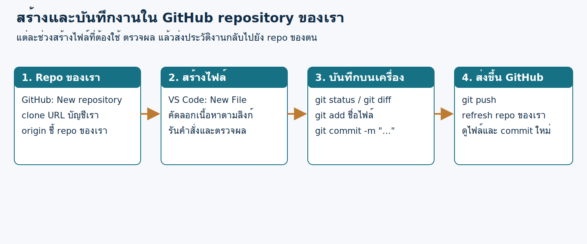
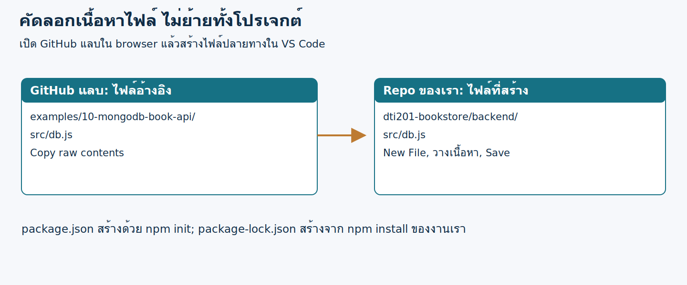

# ช่วง 0 — สร้าง GitHub repository ของเรา แล้วเริ่มโปรเจกต์บนเครื่อง

[กลับหน้า Lab 10](../../labs/10-book-database-crud.md) · ถัดไป: [สร้าง backend และต่อ Atlas](01-atlas-and-sample.md)

เมื่อจบช่วงนี้ บน GitHub ของเราจะมี repo ชื่อ `dti201-bookstore` และบนเครื่องจะมีโฟลเดอร์ที่เชื่อมกับ repo นั้น ภายในมี README กับ .gitignore โค้ด backend และ frontend จะสร้างเพิ่มในช่วงต่อไป

## 0.1 Git, GitHub และ repository ทำหน้าที่ต่างกันอย่างไร

**Git** เป็นโปรแกรมบนเครื่องที่เก็บประวัติไฟล์ **GitHub** เป็นบริการเว็บไซต์ที่เก็บ Git repository ให้เราเข้าถึงและทำงานร่วมกันได้ ส่วน **repository** หรือ **repo** เป็นพื้นที่ของโปรเจกต์ที่มีไฟล์และประวัติการเปลี่ยนแปลง

คำที่เราจะใช้:

| คำ | ทำอะไร | ผลที่เกิดขึ้น |
|---|---|---|
| create repository | สร้างพื้นที่โปรเจกต์บน GitHub | มี URL ของ repo เรา |
| clone | คัดลอก repo นั้นลงเครื่องพร้อมข้อมูล Git | มีโฟลเดอร์งานและ remote ชี้กลับ GitHub |
| edit/create file | สร้างหรือเปลี่ยนเนื้อหาบนเครื่อง | ไฟล์ยังไม่ได้เข้า commit |
| add | เลือกการเปลี่ยนแปลงที่จะบันทึก | อยู่ใน staging area |
| commit | บันทึกชุดการเปลี่ยนแปลงเป็นประวัติบนเครื่อง | มี commit พร้อมข้อความอธิบาย |
| push | ส่ง commit จากเครื่องไป GitHub | เห็นไฟล์และประวัติใหม่บนเว็บไซต์ |



เปิด repo แลบนี้ใน browser เพื่ออ่านคำอธิบายและคัดลอกเนื้อหาไฟล์ที่ระบุ ส่วนงานที่แก้และ commit อยู่ใน `dti201-bookstore` ของเรา ไม่ใช้ Fork, Use this template หรือ Download ZIP เพื่อเริ่มโปรเจกต์นี้

## 0.2 ตรวจเครื่องมือ

เปิด terminal ใช้ Git Bash บน Windows หรือ terminal บน macOS/Linux แล้วรันทีละบรรทัด:

```bash
git --version
node --version
npm --version
```

ควรเห็นเลขรุ่นของแต่ละโปรแกรม ใช้ Node.js **22.12 ขึ้นไป** สำหรับทั้ง backend และ frontend หากได้ command not found ให้ติดตั้งโปรแกรมนั้นก่อน:

- Git: https://git-scm.com/downloads
- Node.js: https://nodejs.org/en/download
- VS Code: https://code.visualstudio.com/download

หลังติดตั้งให้ปิดและเปิด terminal ใหม่แล้วตรวจซ้ำ คำสั่งในกรอบโค้ดให้พิมพ์เฉพาะบรรทัดคำสั่ง ไม่คัดลอกเส้นเปิดและปิดกรอบโค้ด

## 0.3 สร้าง repo บนบัญชี GitHub ของเรา

1. เปิด https://github.com และ sign in ด้วยบัญชีของเรา
2. กดเครื่องหมาย **+** มุมขวาบน แล้วเลือก **New repository** หรือเปิด https://github.com/new
3. ช่อง **Owner** เลือกบัญชีของเรา ตรวจว่าไม่ใช่ organization ของรายวิชา
4. ช่อง **Repository name** ใส่ `dti201-bookstore`
5. ช่อง Description ใส่ `Book catalogue with Express, MongoDB Atlas and React`
6. เลือก **Public** เพื่อเปิด URL งานให้ผู้สอนดูได้ ข้อมูลรับรองจะเก็บเฉพาะบนเครื่องและไม่ push
7. เปิดตัวเลือก **Add a README file** เพื่อให้ repo มี commit แรกและ default branch ตั้งแต่เริ่ม
8. ในส่วน .gitignore เลือก **None** เราจะสร้างไฟล์นี้เองในขั้น 0.6
9. กด **Create repository**

**ผลที่ควรเห็น:** URL มีรูป `https://github.com/ชื่อบัญชีเรา/dti201-bookstore` และรายการไฟล์มี README.md ถ้าชื่อ repo นี้ถูกใช้แล้วในบัญชีเรา อย่าลบงานเก่า ใช้ชื่อใหม่เช่น `dti201-bookstore-lab10` แล้วใช้ชื่อนั้นแทนตลอดคำสั่งที่เหลือ

## 0.4 Clone repo ของเรา

ที่หน้า repo ที่เพิ่งสร้าง กดปุ่ม **Code** เลือกแท็บ **HTTPS** และกดคัดลอก URL URL ต้องมีชื่อบัญชีของเรา ไม่ใช่ `3-courses`

เปิด terminal ในโฟลเดอร์ที่ต้องการเก็บงาน เช่น Documents จากนั้น:

```bash
mkdir -p dti201-work
cd dti201-work
```

วางคำสั่ง git clone ตามด้วย URL ที่คัดลอกมา ตัวอย่างนี้ `YOUR_USERNAME` ต้องแทนด้วยชื่อบัญชีของเรา:

```bash
git clone https://github.com/YOUR_USERNAME/dti201-bookstore.git
cd dti201-bookstore
```

หากใช้ชื่อ repo อื่น ให้ใช้ชื่อเดียวกันทั้ง URL และ cd คำสั่ง clone จะสร้างโฟลเดอร์ให้ จึงไม่ต้อง mkdir dti201-bookstore ก่อน

ตรวจ:

```bash
pwd
ls -a
git remote -v
git status
```

**ผลที่ควรเห็น:**

- pwd ลงท้ายด้วย `dti201-bookstore`
- ls -a เห็น `.git` และ `README.md`; `.git` เก็บข้อมูลประวัติ ไม่แก้ไฟล์ภายในด้วยมือ
- git remote -v แสดงชื่อ `origin` และ URL ของ repo เราสำหรับ fetch/push
- git status แสดงชื่อ branch และ `nothing to commit, working tree clean`

`origin` เป็นชื่อเรียกปลายทาง GitHub ของ repo นี้ หาก URL ชี้ repo แลบ ให้กลับไป clone URL ของเราในอีกโฟลเดอร์ ไม่เริ่มแก้ไฟล์ใน repo ของรายวิชา

## 0.5 เปิดโฟลเดอร์งานใน VS Code

เปิด VS Code → File → Open Folder → เลือก **dti201-bookstore ที่เพิ่ง clone** แล้วเปิด Terminal → New Terminal

ตรวจด้วย `pwd` อีกครั้งว่าลงท้ายด้วยชื่อ repo เรา Explorer ด้านซ้ายควรเห็น README.md ตอนนี้ยังไม่มี src, backend หรือ frontend เราจะสร้างขึ้นตามส่วนที่ใช้

## 0.6 สร้าง .gitignore ก่อนสร้างไฟล์ที่มีรหัสผ่าน

`.gitignore` บอก Git ว่าไฟล์ใดไม่ควรถูกเพิ่มเข้าประวัติ เช่นแพ็กเกจที่ติดตั้งซ้ำได้ และค่าที่มีรหัสผ่านจริง

1. ใน VS Code คลิกโฟลเดอร์ราก `dti201-bookstore`
2. กด **New File** ตั้งชื่อ `.gitignore` มีจุดด้านหน้า ไม่มี .txt ต่อท้าย
3. วางเนื้อหาต่อไปนี้แล้วกด Save:

```gitignore
node_modules/
.env
.env.*
!.env.example
dist/
*.log
.DS_Store
```

- `node_modules/` ไม่เก็บแพ็กเกจที่ npm ดาวน์โหลด
- `.env` และ `.env.*` ไม่เก็บค่าตั้งเครื่องหรือไฟล์รหัสผ่าน
- `!.env.example` ยกเว้นให้เก็บแบบฟอร์มค่าตั้งต้นที่ไม่มีข้อมูลจริง
- `dist/` ไม่เก็บผล build ที่สร้างใหม่ได้

กฎนี้ใช้กับ backend/frontend ในโฟลเดอร์ย่อยด้วย .gitignore ไม่ลบรหัสผ่านที่เคย commit ไปแล้ว จึงสร้างก่อน .env

## 0.7 แก้ README ให้บอกว่างานนี้คืออะไร

เปิด README.md เปลี่ยนเนื้อหาเป็น:

```markdown
# DTI201 Bookstore

แอปจัดการรายการหนังสือด้วย Express, MongoDB Atlas และ React

## โครงสร้าง

- backend: API และการเชื่อมฐานข้อมูล
- frontend: หน้าเว็บ React

## สิ่งที่ทดลอง

- อ่านข้อมูลจาก MongoDB Atlas
- เพิ่ม อ่าน แก้ไข และลบหนังสือผ่าน API
- แสดงและบันทึกข้อมูลจากหน้า React
```

รายการโครงสร้างนี้บอกโฟลเดอร์ที่จะสร้าง ไม่ต้องสร้างทุกไฟล์ล่วงหน้า

## 0.8 Commit และ push งานชุดแรก

ใน terminal ราก repo:

```bash
git status --short
git diff
```

status ควรเห็น README.md ที่แก้และ .gitignore ที่สร้างใหม่ `git diff` แสดงการเปลี่ยนแปลงของไฟล์ที่เคยอยู่ใน Git ส่วนไฟล์ใหม่ยังไม่แสดงใน diff จนกว่าจะ add

เลือกไฟล์แล้วตรวจสิ่งที่จะ commit:

```bash
git add README.md .gitignore
git diff --cached
```

`--cached` แสดงสิ่งที่อยู่ใน staging ตรวจว่าเป็น README และกฎ ignore ไม่มีรหัสผ่าน จากนั้น:

```bash
git commit -m "Initialize bookstore project"
git push
```

หาก Git ขอ user.name/user.email ให้ตั้งสำหรับ repo นี้ โดยแทนชื่อและ email ด้วยข้อมูลที่ใช้กับบัญชีเรา (ใช้ GitHub noreply email จาก Settings → Emails ได้):

```bash
git config user.name "YOUR_NAME"
git config user.email "YOUR_GITHUB_EMAIL"
```

แล้วรัน git commit ใหม่ หาก push ขอ sign in ให้ทำผ่าน browser/credential manager ของ Git ไม่พิมพ์รหัสผ่านหรือ token ลง URL ของ repo

**ผลที่ควรเห็น:** push สำเร็จ กลับหน้า GitHub ของเรา กด refresh จะพบ README ใหม่, .gitignore และข้อความ commit `Initialize bookstore project` บนเครื่อง `git status` กลับเป็น clean

## 0.9 วิธีคัดลอกเนื้อหาไฟล์จาก GitHub แลบ



ในแต่ละช่วงจะมีตารางระบุ: **ไฟล์อ้างอิงบน GitHub แลบ** และ **ไฟล์ที่จะสร้างใน repo เรา** ตำแหน่งอาจต่างกัน เช่นไฟล์อ้างอิงอยู่ใน examples แต่ไฟล์ของเราอยู่ใน backend

ทำกับแต่ละไฟล์ที่ระบุ:

1. กดลิงก์ไฟล์อ้างอิงใน browser จะเห็นชื่อไฟล์และ source code
2. กด **Copy raw contents** เหนือกรอบโค้ด หรือกด **Raw** แล้วคัดลอกเฉพาะเนื้อหาไฟล์ ไม่คัดลอกเลขบรรทัด/หน้า HTML
3. กลับ VS Code เปิดโฟลเดอร์ปลายทางใน repo เรา กด New File ตั้งชื่อตามตาราง
4. วางเนื้อหาแล้ว Save ตรวจตัวพิมพ์เล็กใหญ่และนามสกุล เช่น Book.js ต้องใช้ B ตัวใหญ่
5. เปิดอ่านหน้าที่ของไฟล์และ import ที่คู่มืออธิบาย ก่อนรันคำสั่งตรวจผล

จะใช้วิธีนี้สร้างทีละส่วน ไม่คัดลอกทั้งโฟลเดอร์โปรเจกต์ และไม่คัดลอก `.env`, `node_modules`, `.git` หรือ package-lock.json จาก repo แลบ เราจะสร้าง lock file จาก npm install ของโปรเจกต์เรา

ต่อที่ [สร้าง backend และตั้งค่า Atlas](01-atlas-and-sample.md)

อ้างอิง: [สร้าง repository บน GitHub](https://docs.github.com/en/repositories/creating-and-managing-repositories/creating-a-new-repository), [Clone repository](https://docs.github.com/en/repositories/creating-and-managing-repositories/cloning-a-repository)
