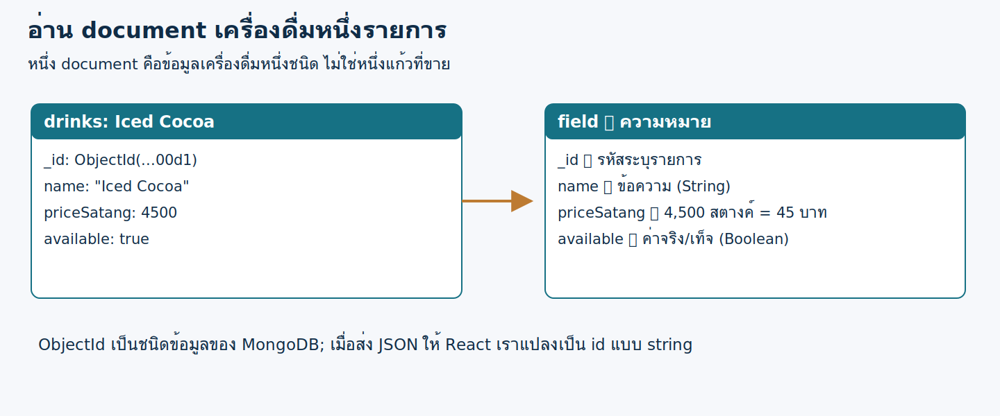

# ช่วง 2 — เริ่มจากเครื่องดื่มสองชนิด: document → model → query → JSON

[กลับหน้า Lab 10](../../labs/10-book-database-crud.md) · ก่อนหน้า: [Atlas และฐานตัวอย่าง](01-atlas-and-sample.md) · ถัดไป: [ER ร้านหนังสือ](../lab10-book-data-model.md)

## 2.1 ทำไมเริ่มจากร้านเครื่องดื่ม


ลองนึกว่าร้านมีเมนูสองชนิด: Iced Cocoa 45 บาท และ Lemon Tea 35 บาท เราต้องเก็บชื่อ ราคา และสถานะว่ายังขายอยู่หรือไม่ ข้อมูลเล็กเท่านี้ก็พอให้เห็นวิธีทำงานของ MongoDB ได้แล้ว

ในภาพ ลูกค้าสั่ง ผู้ขายรับคำขอ และตู้เก็บบัตรเมนูช่วยให้เปิดร้านวันถัดไปแล้วยังจำราคาได้ ในโปรแกรม หน้าเว็บรับสิ่งที่ผู้ใช้ต้องการ Express รับคำขอ และ MongoDB เก็บข้อมูลให้อยู่ข้ามการปิดโปรแกรม เปรียบเทียบหน้าที่เท่านั้น โปรแกรมไม่ได้มีคนคอยค้นบัตรจริง

## 2.2 อ่านข้อมูลทีละ field

กลับ Atlas → `course_books_demo` → `drinks` → Filter `{}` → Find จะเห็น:

| name | priceSatang | available |
|---|---:|---|
| Iced Cocoa | 4500 | true |
| Lemon Tea | 3500 | true |

หนึ่งแถวในตารางข้างบนแทนหนึ่ง **document** คอลัมน์แทน **field** แต่ใน MongoDB ข้อมูลจริงเป็น object ที่มีชื่อ field กับค่า ไม่ได้บังคับให้ทุก document มีคอลัมน์เหมือนตารางเชิงสัมพันธ์เสมอไป เราใช้ model ช่วยกำหนดกติกาที่ต้องการ

ชื่อ `priceSatang` บอกหน่วย **สตางค์**: 4500 ÷ 100 = 45 บาท ไม่ใช่ราคา 4500 บาท ใช้จำนวนเต็มเพื่อให้ตัวอย่างไม่มีปัญหาการคำนวณเงินด้วยทศนิยม

`available: true` เป็น Boolean แปลว่ายังขายอยู่ คำว่า true ไม่มีเครื่องหมายคำพูด หากเขียน `"true"` จะกลายเป็น string ซึ่งเป็นคนละชนิดข้อมูล



`_id` เป็นรหัสของ document MongoDB ใช้ ObjectId ซึ่งไม่ใช่เลขลำดับ 1, 2 ในตัวอย่างเรากำหนดรหัสคงที่เพื่อให้เปิดตามได้ ส่วนแอปหนังสือภายหลังให้ MongoDB สร้างรหัสใหม่

## 2.3 ดูต้นทางข้อมูลที่ seed

ใน VS Code เปิด `demo/data.js` มองหาชื่อ `drinks`:

```js
drinks: [
  { _id: id('d1'), name: 'Iced Cocoa', priceSatang: 4500, available: true },
  { _id: id('d2'), name: 'Lemon Tea', priceSatang: 3500, available: true }
]
```

- `[` และ `]` ครอบ array ซึ่งเก็บหลายรายการ
- `{` และ `}` ครอบ object ของแต่ละรายการ
- `name:` เป็นชื่อ field ส่วน `'Iced Cocoa'` เป็นค่า
- `id('d1')` เรียก helper ที่เติมศูนย์ด้านหน้าให้ครบ 24 ตัวแล้วสร้าง ObjectId เป็นเพียงวิธีเตรียมรหัสตัวอย่าง ไม่ต้องใช้วิธีนี้กับหนังสือที่เพิ่มผ่านเว็บ

ไฟล์ `demo/sample-db.js` อ่าน array นี้แล้วใช้ `updateOne` กับ `$setOnInsert` ถ้ามี ID เดิมอยู่แล้วจะไม่เขียนทับ จึงรัน demo:seed ซ้ำได้โดยไม่ล้างฐานข้อมูล

## 2.4 Mongoose อยู่ตรงไหน

MongoDB คือระบบที่เก็บข้อมูล ส่วน **Mongoose** คือไลบรารี JavaScript ใน Node.js ที่ช่วยกำหนดกติกาและสั่ง query จากโค้ด ไม่ใช่อีก database หนึ่ง

เปิด `demo/Drink.js` ไฟล์นี้มีให้ครบแล้ว:

```js
import mongoose from 'mongoose';

const drinkSchema = new mongoose.Schema({
  name: { type: String, required: true, trim: true },
  priceSatang: { type: Number, required: true, min: 0, validate: Number.isInteger },
  available: { type: Boolean, required: true }
}, { collection: 'drinks', bufferCommands: false });

export const Drink = mongoose.model('Drink', drinkSchema);
```

อ่านทีละส่วน:

1. `import` นำไลบรารี Mongoose เข้ามาใช้ในไฟล์นี้
2. `new mongoose.Schema(...)` สร้างคำอธิบายโครงสร้างข้อมูลที่โปรแกรมคาดหวัง **ยังไม่เขียนข้อมูลลง MongoDB**
3. `String`, `Number`, `Boolean` ระบุชนิดของค่า `required: true` หมายถึงต้องมี field นี้ตอนสร้าง/ตรวจผ่าน model
4. `trim: true` ตัดช่องว่างหัวท้ายชื่อ `min: 0` ป้องกันราคาติดลบ และ `Number.isInteger` ตรวจว่าเป็นจำนวนเต็ม
5. `collection: 'drinks'` ระบุชื่อ collection ที่ model นี้ใช้อ่าน/เขียนโดยตรง
6. `bufferCommands: false` ไม่พักคำสั่งไว้รอ connection อย่างเงียบ ๆ หากเรายังต่อ DB ไม่สำเร็จ
7. `mongoose.model('Drink', drinkSchema)` สร้าง model ที่เรียกคำสั่งเช่น `Drink.find()` ได้
8. `export` ทำให้ไฟล์อื่น import ชื่อ `Drink` ไปใช้ได้

Schema ของ Mongoose ตรวจการเขียนที่ผ่าน Mongoose ไม่ได้ย้อนหลังตรวจทุก document ที่มีอยู่ และไม่ได้ทำให้การแก้ผ่าน Atlas UI ต้องผ่าน validator ของ JavaScript ชุดนี้

## 2.5 เปิด connection ก่อน query

เปิด `demo/drinks.js` ช่วงเริ่มต้น:

```js
import mongoose from 'mongoose';
import { connectDatabase, reportDatabaseError } from '../src/db.js';
import { Drink } from './Drink.js';
```

`../src/db.js` หมายถึงจากโฟลเดอร์ demo ย้อนขึ้นหนึ่งระดับแล้วเข้า src ส่วน `./Drink.js` หมายถึงไฟล์ในโฟลเดอร์เดียวกัน ชื่อไฟล์ตัวใหญ่เล็กต้องตรง โดยเฉพาะเมื่อรันบน Linux

ต่อมา:

```js
await connectDatabase({ dbName: 'course_books_demo' });
```

connection คือช่องทางติดต่อจากโปรแกรมไป MongoDB helper อ่าน URI จาก `.env` แต่เลือกฐาน demo สำหรับตัวอย่างนี้ `await` หมายถึงรอให้การเชื่อมสำเร็จก่อนทำบรรทัดถัดไป ถ้าไม่รอ โปรแกรมอาจเริ่ม query ก่อนเชื่อมได้

## 2.6 สั่งค้นหาและรอผล

บรรทัดต่อไปในไฟล์เดียวกัน:

```js
const documents = await Drink.find({ available: true }).sort({ name: 1 });
```

- `Drink.find(...)` ค้นหลาย document จาก collection drinks
- `{ available: true }` คือเงื่อนไขเดียวกับ Filter ใน Atlas: เอาเฉพาะรายการที่ยังขาย
- `.sort({ name: 1 })` เรียงชื่อตามลำดับเพิ่มขึ้น ค่า `1` ที่นี่หมายถึงทิศทางการเรียง ไม่ใช่ราคา/ID หรือจำนวนรายการ
- `await` รอผล query แล้วเก็บ array ไว้ในตัวแปร `documents`

สำหรับข้อมูลตั้งต้นจะได้ Iced Cocoa ก่อน Lemon Tea ทั้งสองผ่านเงื่อนไขเพราะ available เป็น true

## 2.7 แปลงผลเป็นข้อมูลที่ส่งต่อได้

```js
const data = documents.map(document => ({
  id: String(document._id),
  name: document.name,
  priceSatang: document.priceSatang,
  available: document.available
}));
console.log(JSON.stringify({ data }, null, 2));
```

`map` เดินทีละ document แล้วสร้าง object ใหม่ เราเลือก field ที่ส่งออกชัดเจน `String(document._id)` เปลี่ยน ObjectId เป็นข้อความในชื่อ `id` สำหรับใช้กับ JavaScript/JSON ข้อมูลต้นฉบับใน DB ยังใช้ `_id` เหมือนเดิม

`JSON.stringify` แปลง object เป็นข้อความ JSON `null, 2` ช่วยจัดย่อหน้าให้อ่านง่าย ยังไม่ได้ส่ง HTTP ขั้นนี้พิมพ์ผลใน terminal ก่อน เพื่อเห็นการอ่านฐานข้อมูลโดยไม่ต้องเข้าใจ route พร้อมกัน

## 2.8 รันไฟล์นี้ด้วยคำสั่งที่เตรียมไว้

ที่ terminal backend:

```bash
npm run demo:drinks
```

จะเห็นรูปแบบนี้ โดย ID ของข้อมูลสาธิตเป็นค่าคงที่:

```json
{
  "data": [
    { "id": "0000000000000000000000d1", "name": "Iced Cocoa", "priceSatang": 4500, "available": true },
    { "id": "0000000000000000000000d2", "name": "Lemon Tea", "priceSatang": 3500, "available": true }
  ]
}
```

เทียบชื่อและราคากับ Atlas จะตรงกัน โปรแกรมนี้เปิด connection → อ่าน → แปลง → พิมพ์ → `finally` ปิด connection ด้วย `mongoose.disconnect()` จึงทำงานจบแล้วคืน terminal ให้เรา ไม่ใช่ server ที่เปิดรอคำขอ

ถ้าเห็น `data: []` ให้กลับไปช่วง 1 รัน `npm run demo:seed` แล้วตรวจว่าอยู่ฐาน demo ถ้า connection error ให้ตรวจ `.env`/IP/สิทธิ์ ไม่ต้องแก้ Drink schema

## 2.9 ใช้วิธีเดิมกับหนังสืออย่างไร

| เครื่องดื่มที่เพิ่งดู | หนังสือที่จะทำต่อ |
|---|---|
| Drink schema | Book schema |
| collection drinks | collection books |
| name/priceSatang/available | title/author/sourceType/summary |
| Drink.find | Book.find |
| map document เป็นข้อมูลส่งออก | map เป็น API book ที่มี id string |
| console.log แสดง JSON | Express ส่ง JSON ให้ React |

ตอนนี้เราได้เห็นทุกส่วนทำงานกับข้อมูลเพียงสองรายการแล้ว ต่อไปจะขยายความเข้าใจเรื่องความสัมพันธ์ด้วย [ER ร้านหนังสือทั้งสามภาพ](../lab10-book-data-model.md)
