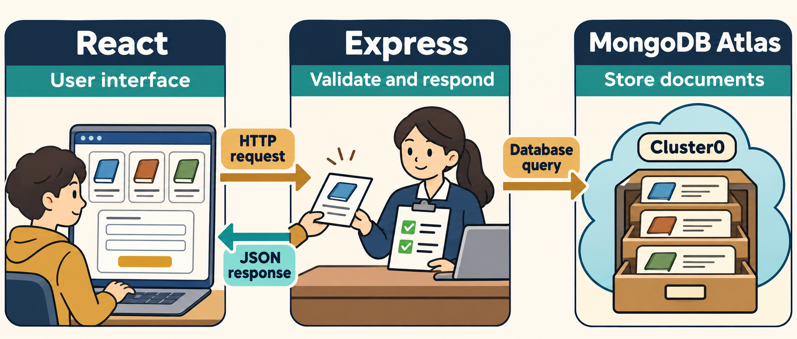
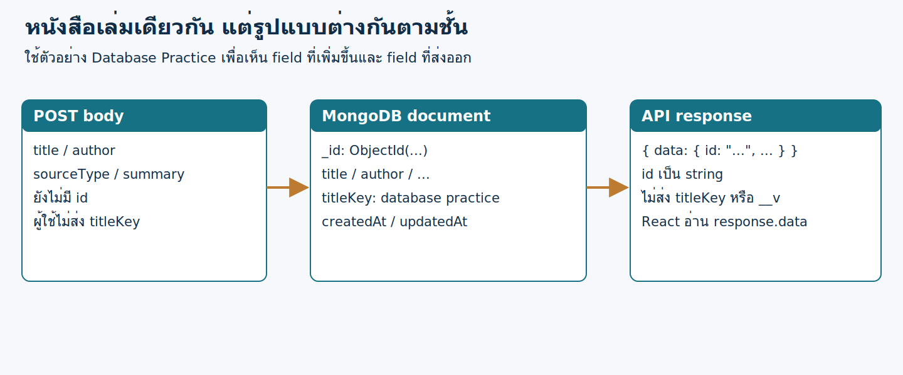
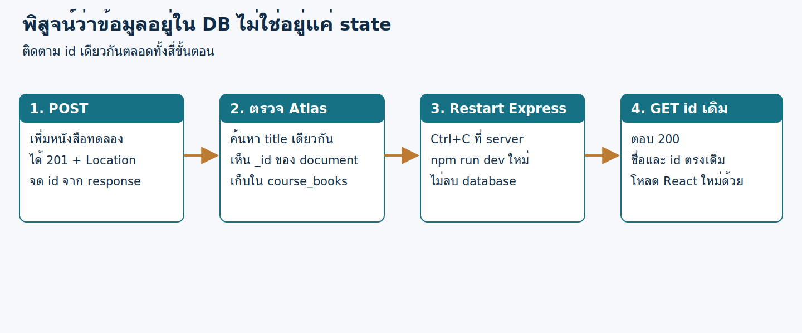

# ช่วง 4 — เชื่อม Book model กับ API แล้วทดลองทีละคำขอ

[กลับหน้า Lab 10](../../labs/10-book-database-crud.md) · ก่อนหน้า: [ER และ model](../lab10-book-data-model.md) · ถัดไป: [React](04-react-and-checks.md)

## 4.1 รู้จักส่วนประกอบที่จะเปิดใช้



**React** อยู่ใน browser ทำหน้าที่แสดงข้อมูลและรับสิ่งที่ผู้ใช้กรอก **Express** เป็นไลบรารีที่ทำงานใน Node.js บน backend รับ HTTP request ตรวจข้อมูล เรียกฐานข้อมูล และส่ง response ส่วน **MongoDB Atlas** เป็นบริการที่ให้ MongoDB เก็บข้อมูลไว้บน cloud

**Node.js** คือโปรแกรมที่รันไฟล์ JavaScript นอก browser เราจึงใช้ JavaScript รับคำขอและติดต่อฐานข้อมูลได้ **API** คือช่องทางที่โปรแกรมตกลงกันว่าจะส่งคำขอไปที่ไหนและได้คำตอบแบบใด เช่น GET `/api/books` ขอรายการหนังสือ

ช่วงนี้ยังไม่เปิด React เราจะใช้ **curl** ซึ่งเป็นโปรแกรมส่ง HTTP จาก terminal เพื่อดูว่าหลังบ้านทำงานถูกก่อน ถ้าเห็นผลใน curl ได้แล้ว จึงนำหน้าเว็บมาเรียกช่องทางเดียวกัน

## 4.2 ข้อมูลของแอปหลักต่างจากร้าน demo อย่างไร

ใน `.env` ตั้งฐานหลักเป็น `course_books` เหมือนช่วง 1 เราใช้ Book metadata สี่ field คือชื่อ ผู้แต่ง ประเภท และสรุป schema นี้ไม่รับราคา/stock/categoryId จากฐาน demo



อ่านภาพจากซ้ายไปขวา: ผู้ใช้กรอกสี่ field → server สร้าง titleKey และ MongoDB มี `_id` → API ส่งกลับ `id` ที่เป็น string โดยไม่ส่ง field ภายใน เราไม่ได้ให้ React เชื่อม MongoDB โดยตรง

## 4.3 สร้าง Book model และอ่านกติกา

ที่ terminal backend สร้างโฟลเดอร์:

```bash
mkdir -p src/models
```

ใน VS Code คลิก backend/src/models → New File → ตั้งชื่อ **Book.js** คัดลอกโค้ดด้านล่างหรือเปิด [Book.js บน GitHub แลบ](../../examples/10-mongodb-book-api/src/models/Book.js) แล้วคัดลอกเนื้อหา วางและ Save

```js
import mongoose from 'mongoose';

const bookSchema = new mongoose.Schema({
  title: { type: String, required: true, trim: true, minlength: 3 },
  author: { type: String, required: true, trim: true },
  sourceType: { type: String, required: true, enum: ['book', 'documentation', 'course'] },
  summary: { type: String, required: true, trim: true },
  titleKey: { type: String, required: true }
}, { timestamps: true, bufferCommands: false });
bookSchema.index({ titleKey: 1 }, { unique: true });
export const Book = mongoose.model('Book', bookSchema);
```

เทียบกับ Drink schema ที่อ่านมาแล้ว รูปแบบเหมือนกัน แต่ Book มี field เพิ่ม:

| ส่วนใน schema | หน้าที่ | ตัวอย่างผล |
|---|---|---|
| `required: true` | ต้องมีค่า | ไม่ส่ง author จะไม่ผ่าน |
| `trim: true` | ตัดช่องว่างหัวท้าย | `" Mali "` เก็บเป็น `"Mali"` |
| `minlength: 3` | ชื่อต้องยาวอย่างน้อย 3 ตัว | `"ab"` ไม่ผ่าน |
| `enum` | อนุญาตค่าที่ระบุเท่านั้น | sourceType เป็น `book`, `documentation`, `course` |
| `timestamps: true` | Mongoose เพิ่มวันที่สร้าง/แก้ | createdAt, updatedAt |
| unique index บน titleKey | MongoDB กันชื่อที่ normalize แล้วซ้ำ | Database Practice กับ database practice ชนกัน |

`titleKey` คือชื่อที่ server trim แล้วเปลี่ยนเป็นตัวพิมพ์เล็ก ใช้เป็นกติกาชื่อไม่ซ้ำของแลบนี้ ไม่ใช่กฎว่าหนังสือจริงทุกฉบับต้องชื่อไม่ซ้ำ `unique` เป็น index ไม่ใช่ Mongoose validator จึงต้องจัดการ duplicate-key error ต่างหาก

## 4.4 สร้าง seed script แล้วเพิ่มหนังสือ 200 เล่ม

สร้างไฟล์สองรายการนี้ใน VS Code และคัดลอกเนื้อหาจากลิงก์:

| ไฟล์อ้างอิงใน GitHub แลบ | สร้างใน repo เรา | หน้าที่ |
|---|---|---|
| [src/books.js](../../examples/10-mongodb-book-api/src/books.js) | `backend/src/books.js` | metadata หนังสือ 200 เล่ม |
| [scripts/seed.js](../../examples/10-mongodb-book-api/scripts/seed.js) | `backend/scripts/seed.js` | อ่าน metadata แล้วเพิ่มผ่าน Book model |

ใน scripts/seed.js ดู import ไป ../src/models/Book.js และ ../src/books.js: ตอนนี้เราสร้างปลายทางทั้งสองแล้ว เพิ่มคำสั่งจาก terminal backend:

```bash
npm pkg set 'scripts.seed=node --env-file=.env scripts/seed.js'
```

เปิด terminal ที่ `dti201-bookstore/backend`:

```bash
npm run seed
npm run seed
npm run db:check
```

บนฐานใหม่ seed ทั้งสองครั้งต้องเห็น `Seed complete. Books: 200` ส่วน db:check เห็น ping OK, Books: 200 และตัวอย่างสามเล่ม การรันซ้ำใช้ `$setOnInsert` ไม่เพิ่มชื่อเดิมซ้ำและไม่ทับข้อมูลที่แก้ไว้แล้ว ถ้าเคยเพิ่มหนังสืออื่น จำนวนอาจเกิน 200 ไม่ต้องลบทิ้ง

เปิด Atlas → **course_books → books** (ไม่ใช่ course_books_demo) → Filter `{ "title": "Pride and Prejudice" }` → Find จะเห็นเล่มเดียวกับที่ seed มา ขยายดู title/author/sourceType/summary และ titleKey

## 4.5 เปิด store: ส่วนที่คุยกับ model

ใน backend/src สร้างไฟล์ **book-store.js** วางโค้ดด้านล่างแล้ว Save (อ้างอิง [book-store.js](../../examples/10-mongodb-book-api/src/book-store.js)) คำว่า **store** หมายถึงกลุ่มฟังก์ชันสำหรับอ่าน/เพิ่ม/แก้/ลบข้อมูล ไฟล์นี้เรียก Book model แล้วแปลงผลเป็นข้อมูลที่ API ส่งออก:

```js
import { Book } from './models/Book.js';

// Send an explicit public shape, not Mongoose's internal fields.
export function toApiBook(document) {
  return {
    id: String(document._id),
    title: document.title,
    author: document.author,
    sourceType: document.sourceType,
    summary: document.summary
  };
}

export function createBookStore() {
  return {
    async list({ limit, offset }) {
      const documents = await Book.find().sort({ _id: 1 }).skip(offset).limit(limit);
      return documents.map(toApiBook);
    },
    async find(id) {
      const document = await Book.findById(id);
      return document ? toApiBook(document) : null;
    },
    async insert(command) {
      const titleKey = command.title.trim().toLocaleLowerCase();
      const document = await Book.create({ ...command, titleKey });
      return toApiBook(document);
    },
    async update(id, command) {
      const changes = { ...command };
      if (changes.title !== undefined) changes.titleKey = changes.title.trim().toLocaleLowerCase();
      const document = await Book.findByIdAndUpdate(id, { $set: changes }, { new: true, runValidators: true });
      return document ? toApiBook(document) : null;
    },
    async remove(id) {
      const document = await Book.findByIdAndDelete(id);
      return document !== null;
    }
  };
}
```

เดินอ่านตามลำดับนี้:

1. `import { Book }` ใช้ model จากไฟล์ที่เพิ่งอ่าน
2. `toApiBook` สร้าง object ใหม่ เลือก field สาธารณะ และแปลง `_id` เป็น `id` string ทุก route จึงตอบรูปแบบเดียวกัน
3. `createBookStore()` คืน object ที่มีฟังก์ชันห้าตัวให้ routes เรียก
4. `list` ใช้ find ค้นหลายเล่ม sort ตาม `_id` แล้ว skip/limit ถ้า offset=2, limit=2 คือข้ามสองเล่มแรกแล้วเอาสองเล่มถัดไป ไม่ใช่หา id=2
5. `find` ใช้ findById ได้หนึ่ง document หรือ null จากนั้นแปลงเฉพาะเมื่อพบ
6. `insert` สร้าง titleKey เอง ใช้ Book.create บันทึกหนึ่ง document แล้วคืนข้อมูลสาธารณะ
7. `update` ใช้ `$set` แก้เฉพาะ field ที่ส่งมา `new: true` ให้ได้ผลหลังแก้ `runValidators: true` ให้ตรวจ schema ระหว่าง update ด้วย
8. `remove` ลบ document ตาม ID แล้วคืน true/false ว่าพบและลบได้หรือไม่

ทุกฟังก์ชัน query ใช้ `async` และ `await` เพราะรอการตอบจาก DB ใช้เวลามากกว่าคำนวณในหน่วยความจำ ถ้าไม่ await จะได้สิ่งที่แทนงานที่ยังไม่เสร็จ ไม่ใช่ array หนังสือที่พร้อมส่ง

## 4.6 เปิด routes: ส่วนที่รับ HTTP

ใน backend/src สร้างไฟล์ **app.js** คัดลอกเนื้อหาจาก [src/app.js](../../examples/10-mongodb-book-api/src/app.js) แล้ว Save เปิดอ่านว่าแต่ละ method และ URL เรียกฟังก์ชันใด ตารางนี้อธิบายชื่อที่ใช้ใน routes:

| คำในโค้ด | หมายถึงอะไร |
|---|---|
| `app.get`, `app.post`, `app.patch`, `app.delete` | กำหนดว่าจะรับ HTTP method ไหนที่ path ใด |
| `req` | request จากผู้เรียก เช่น body, query และ params |
| `res` | response ที่เราจะส่งกลับ พร้อม status/header/JSON |
| `req.query` | ค่าหลัง `?` ใน URL เช่น limit=2 |
| `req.params.id` | ค่าที่แทน `:id` ใน URL |
| `req.body` | object ที่แปลงจาก JSON ในคำขอ |
| `express.json` | middleware ที่อ่าน body เป็น JavaScript object |
| `readCommand` | ฟังก์ชันของเราเพื่อตรวจ field และชนิดข้อมูลก่อนส่งเข้า store |
| `problem` | ฟังก์ชันตอบ error ในรูปแบบเดียวกัน |

ส่วนที่เรียก store และตอบ GET list:

```js
const data = await store.list({ limit: take, offset: skip });
res.json({ data, pagination: { limit: take, offset: skip } });
```

route ตรวจ limit/offset ก่อนบรรทัดนี้ แล้วส่งตัวเลขที่ผ่านการตรวจเข้า store จากนั้นตอบ JSON เช่น `{data:[...],pagination:{limit:2,offset:0}}`

ตัวอย่าง POST หลังตรวจข้อมูลแล้ว:

```js
const book = await store.insert(command);
res.status(201).location(`/api/books/${book.id}`).json({ data: book });
```

`201` แปลว่าสร้างรายการสำเร็จ `Location` เป็น response header บอก URL ของรายการใหม่ และ `data` เป็นข้อมูลหนังสือ ไม่ส่ง URI หรือรหัส DB ให้ client

`readCommand` ปฏิเสธ field นอกสี่ field รวมทั้ง `_id`, `titleKey`, `$set` หรือ object แทน string เราจึงไม่เอา req.body ทั้งก้อนส่งตรงเข้า MongoDB ส่วน `app.param('id', ...)` ตรวจให้ ID มี hexadecimal 24 ตัวก่อนทุก route ที่ใช้ ID

ท้ายไฟล์ error middleware แปลง JSON เสียเป็น 400, body ใหญ่เกินเป็น 413, ข้อมูลไม่ผ่านเป็น 422, ชื่อซ้ำเป็น 409 และ DB error ที่ไม่คาดคิดเป็น 500 โดยไม่ส่ง driver message ออก ทุก response มี X-Request-Id สำหรับจับคู่คำขอกับ error ที่เห็น

## 4.7 เปิด server แล้วค่อยส่งคำขอ

ใน backend/src สร้างไฟล์ **server.js** คัดลอกเนื้อหาจาก [src/server.js](../../examples/10-mongodb-book-api/src/server.js) แล้ว Save ไฟล์นี้ import db.js, models/Book.js และ app.js ที่สร้างมาก่อน จึงต้องสะกดชื่อให้ตรง

เพิ่มคำสั่งเปิด server จาก terminal backend:

```bash
npm pkg set 'scripts.dev=node --env-file=.env --watch src/server.js'
npm pkg set 'scripts.start=node --env-file=.env src/server.js'
```

เปิด src/server.js ดูลำดับสำคัญ:

```js
await connectDatabase();
await Book.init();
const app = createApp();
```

connectDatabase ต่อ URI จาก `.env`; Book.init รอ model/index พร้อม; createApp ประกอบ routes แล้วจึง app.listen เปิด port 3001 ถ้า DB ต่อไม่ได้ โปรแกรมต้องหยุด ไม่แสดงว่าพร้อม

ใน terminal **A** ที่ backend รัน:

```bash
npm run dev
```

ควรเห็น `API listening on port 3001` ปล่อย terminal A ไว้ โปรแกรมกำลังรอคำขอ เปิด Terminal → New Terminal อีกหน้าชื่อ **B** ใช้ส่ง curl ไม่พิมพ์คำสั่งต่อท้าย log ของ A

ถ้าใช้ PowerShell ให้ใช้ `curl.exe` แทน `curl` หรือเปิด Git Bash เพื่อใช้รูปแบบคำสั่งด้านล่าง คำสั่งหลายบรรทัดมี `\` ต่อบรรทัดสำหรับ Bash

## 4.8 อ่านรายการ: GET

ใน B:

```bash
curl -i 'http://localhost:3001/api/books?limit=2&offset=0'
```

`curl` ส่งคำขอ `-i` ให้แสดง status/header ด้วย `http://localhost:3001` คือ Express บนเครื่องเรา `/api/books` คือ route และ query ขอ 2 รายการแรก

ควรเห็น `HTTP/1.1 200 OK` และ JSON ที่ `data` เป็น array สองเล่ม แต่ละเล่มมี `id` string จด ID จริงเล่มหนึ่งไว้ ในคู่มือใช้คำว่า BOOK_ID เป็นช่องแทนค่า ไม่ใช่ ID จริง

## 4.9 อ่านหนึ่งเล่ม: GET detail

ใน B แทน `BOOK_ID` ทั้งคำด้วยค่าที่คัดลอกจาก response:

```bash
curl -i http://localhost:3001/api/books/BOOK_ID
```

ตัวอย่างรูปแบบ path ที่ถูกต้องคือ `/api/books/674000000000000000000001` แต่ ID ตัวอย่างนี้อาจไม่มีในฐานเรา ต้องใช้ ID ที่เพิ่งอ่านมา ผลที่ควรได้คือ 200 และ `data` เป็น object หนึ่งเล่ม ชื่อและ ID ตรงกับ list

## 4.10 เพิ่มหนังสือ: POST

ใน B:

```bash
curl -i -X POST http://localhost:3001/api/books \
  -H 'Content-Type: application/json' \
  -d '{"title":"Database Practice","author":"Mali","sourceType":"course","summary":"สรุปจากการทดลองของฉัน"}'
```

`-X POST` เลือก method เพิ่มข้อมูล `-H` บอกว่า body เป็น JSON `-d` ตามด้วยข้อมูลสี่ field เครื่องหมายคำพูดชื่อ key และ string ใน JSON ต้องเป็น `"` ส่วน single quote ด้านนอกเป็นวิธีครอบข้อความใน Bash

ควรได้ **201 Created**, header **Location: /api/books/รหัสใหม่** และ `data.id` ให้จด Location ไว้ เปิด Atlas → course_books.books → Filter `{ "title": "Database Practice" }` → Find ควรเห็น document เดียวกันพร้อม titleKey

ถ้าได้ 409 แปลว่าชื่อนี้อยู่แล้วจากการทดลองก่อน ไม่ต้องล้างฐาน เปลี่ยน title เป็น `Database Practice Round 2` แล้ว POST ใหม่

## 4.11 พิสูจน์ว่าข้อมูลอยู่หลังปิดโปรแกรม



1. จด ID/Location จาก POST ที่ได้ 201
2. ที่ terminal A กด **Ctrl+C** จนกลับมาพิมพ์คำสั่งได้ เป็นการหยุด Express ไม่ใช่ลบ DB
3. ใน A รัน `npm run dev` ใหม่ รอ API listening
4. ใน B ใช้ GET ตาม Location ที่จดไว้:

```bash
curl -i http://localhost:3001/api/books/BOOK_ID
```

แทน BOOK_ID ด้วยรหัสจริง ผลต้องเป็น 200 และข้อมูลเดิม นี่คือหลักฐาน persistence เพราะ process เดิมหยุดไปแล้ว แต่ document อยู่ใน MongoDB และ process ใหม่อ่านกลับมาได้

## 4.12 แก้เฉพาะสรุป: PATCH

ใช้ ID ของ **หนังสือทดลองที่เพิ่มเอง** ไม่ใช้ seed เล่มอื่น:

```bash
curl -i -X PATCH http://localhost:3001/api/books/BOOK_ID \
  -H 'Content-Type: application/json' \
  -d '{"summary":"แก้สรุปแล้ว ข้อมูลนี้อยู่ใน MongoDB"}'
```

แทน BOOK_ID ก่อนรัน ควรได้ 200 และ summary ใหม่โดย title/author ยังเหมือนเดิม PATCH ส่งเฉพาะ field ที่ต้องแก้ได้ เปิด Atlas กด Find/refresh จะเห็น summary เปลี่ยนและ updatedAt ใหม่

## 4.13 ลบหนังสือทดลอง: DELETE

```bash
curl -i -X DELETE http://localhost:3001/api/books/BOOK_ID
```

ใช้ ID ของหนังสือทดลองเดิมที่พร้อมลบ ควรได้ **204 No Content** ไม่มี body นี่เป็นผลสำเร็จ ไม่ใช่ JSON หาย ลอง GET ID เดิมอีกครั้งจะได้ **404 Book not found** และ Atlas ค้น ID นั้นไม่พบ

DELETE ของ API นี้ลบ metadata ในแอปฝึก ไม่ใช้กับฐานร้านเต็มที่มีประวัติคำสั่งซื้อ ซึ่งต้องวางกติกาไม่ลบสินค้าที่มีประวัติอ้างอิงตามภาพ ER

## 4.14 ดู error ที่โปรแกรมจัดการให้แล้ว

รันคำสั่งเหล่านี้ทีละอัน แล้วเทียบ HTTP status กับสาเหตุด้านล่าง:

```bash
curl -i http://localhost:3001/api/books/1
curl -i http://localhost:3001/api/books/000000000000000000000000
curl -i 'http://localhost:3001/api/books?limit=0'
curl -i -X POST http://localhost:3001/api/books -H 'Content-Type: application/json' -d '{"title":"ab"}'
curl -i -X POST http://localhost:3001/api/books -H 'Content-Type: application/json' -d '{'
```

ผลตามลำดับคือ 422 (ID ผิดรูป), 404 (ID ถูกรูปแต่ไม่มี), 422 (limit นอกช่วง), 422 (field ไม่ครบ/ชื่อสั้น), 400 (JSON เสีย) ตัวอย่าง error body มี title/status/requestId ไม่ใช่ stack trace หรือ URI

ต่อที่ [ช่วง 5 เปิด React ใช้ API เดียวกัน](04-react-and-checks.md)

## 4.15 Commit API ที่ทดลองแล้ว

หยุด Express ใน terminal A ด้วย Ctrl+C จาก terminal backend กลับราก repo:

```bash
cd ..
git status --short
git add backend/src backend/scripts backend/package.json backend/package-lock.json
git diff --cached
git commit -m "Add persistent book CRUD API"
git push
cd backend
```

บน GitHub repo เราจะเห็น Book model, book-store.js, app.js, server.js และ seed script อยู่ใน backend ของตน ไม่มี .env อยู่ใน commit เปิด Express ต่อได้ด้วย npm run dev ใน backend
