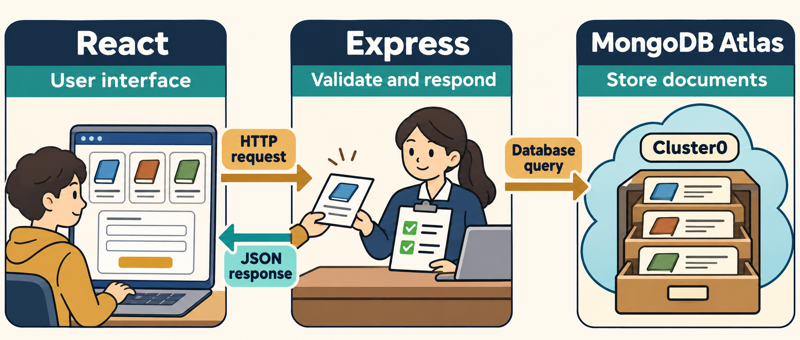
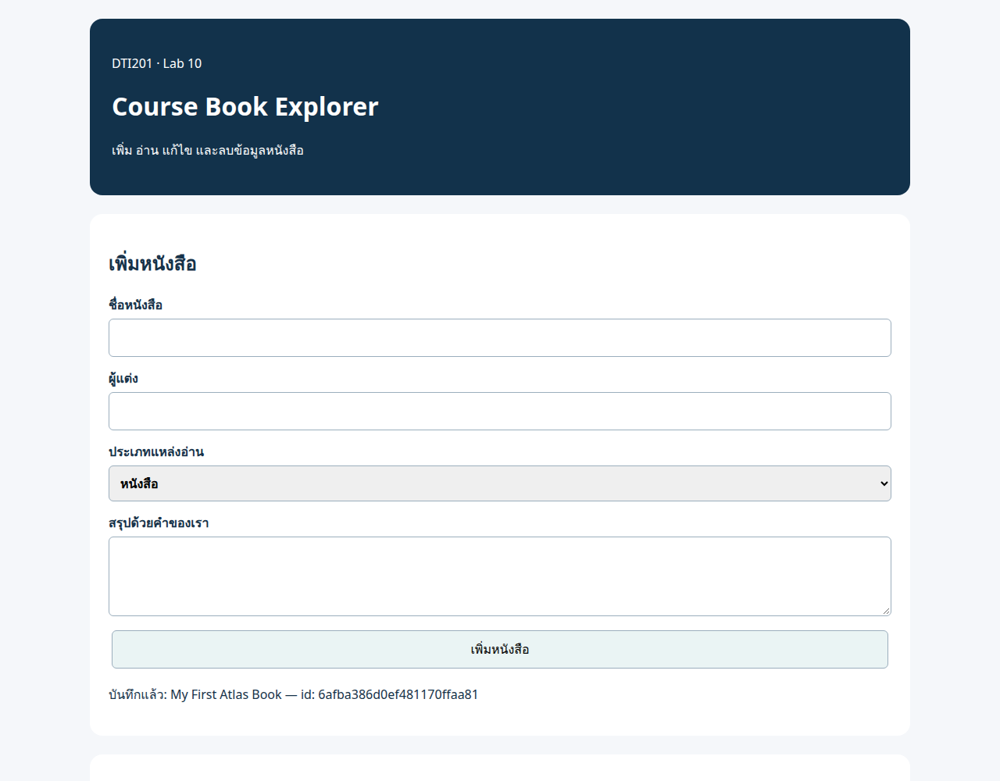
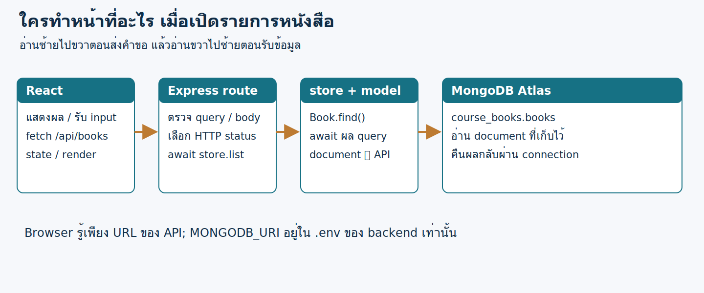

# ช่วง 5 — เปิด React แล้วติดตามจากฟอร์มถึง Atlas

[กลับหน้า Lab 10](../../labs/10-book-database-crud.md) · ก่อนหน้า: [Book API](03-book-api-walkthrough.md)

## 5.1 Frontend ไม่ใช่ database



Frontend คือส่วนที่แสดงใน browser ผู้ใช้เห็นฟอร์ม รายการ และปุ่ม React ช่วยจัดหน้าตาจากข้อมูลใน **state** ซึ่งเป็นค่าที่หน้าเว็บกำลังจำไว้ ถ้า refresh state เดิมหายได้ เราจึงให้ React โหลดข้อมูลที่บันทึกใน DB กลับมาผ่าน API

Vite เป็นเครื่องมือเปิด frontend ระหว่างพัฒนา ไม่ใช่ Express และไม่ใช่ MongoDB วันนี้จึงมี terminal ของ Express และ terminal ของ Vite เปิดพร้อมกัน ส่วน MongoDB อยู่บน Atlas

## 5.2 สร้าง frontend ใน repo เรา

เปิด Express ที่สร้างในช่วง 4 ไว้ใน terminal A หากยังไม่ได้เปิด ให้เข้า `dti201-bookstore/backend` แล้วรัน `npm run dev` รอ API listening on port 3001

เปิด terminal **C** ใหม่ที่ราก `dti201-bookstore` ตรวจด้วย pwd แล้วรัน:

```bash
mkdir frontend
cd frontend
npm init -y
npm pkg set type=module
npm install react@19.3.1 react-dom@19.3.1
npm install -D vite@8.3.8 @vitejs/plugin-react@6.3.0
mkdir src
```

React สร้างส่วนแสดงผล react-dom นำ React ไปแสดงในหน้า HTML ส่วน Vite และ plugin-react เป็นเครื่องมือระหว่างพัฒนา จึงใส่ `-D` เพื่อบันทึกเป็น devDependencies

**ผลที่ควรเห็น:** frontend มี package.json, package-lock.json, node_modules และ src ที่ยังว่าง เป็น package คนละชุดกับ backend แต่เก็บอยู่ใน Git repo เดียวกัน

เพิ่มคำสั่ง npm ของ frontend:

```bash
npm pkg set 'scripts.dev=vite --host 127.0.0.1'
npm pkg set 'scripts.build=vite build'
npm pkg set 'scripts.preview=vite preview --host 127.0.0.1'
```

สร้างแต่ละไฟล์ใน VS Code แล้วคัดลอกเนื้อหาจากลิงก์อ้างอิงตามตาราง **ชื่อโฟลเดอร์ client ใน repo แลบ เปลี่ยนเป็น frontend ในงานเรา** แต่เนื้อหา import ภายในยังใช้ได้เพราะลำดับไฟล์ข้างในตรงกัน:

| ไฟล์อ้างอิงใน GitHub แลบ | สร้างใน repo เรา | หน้าที่ |
|---|---|---|
| [client/index.html](../../examples/10-mongodb-book-api/client/index.html) | `frontend/index.html` | HTML ที่มี root สำหรับ React และโหลด main.jsx |
| [client/vite.config.js](../../examples/10-mongodb-book-api/client/vite.config.js) | `frontend/vite.config.js` | เปิด port 5174 และส่ง /api ไป Express |
| [client/src/main.jsx](../../examples/10-mongodb-book-api/client/src/main.jsx) | `frontend/src/main.jsx` | นำ App และ CSS ไปแสดงใน root |
| [client/src/style.css](../../examples/10-mongodb-book-api/client/src/style.css) | `frontend/src/style.css` | รูปแบบตัวอักษร ฟอร์ม และรายการ |
| [client/src/api.js](../../examples/10-mongodb-book-api/client/src/api.js) | `frontend/src/api.js` | ส่ง HTTP และอ่าน response/error |
| [client/src/App.jsx](../../examples/10-mongodb-book-api/client/src/App.jsx) | `frontend/src/App.jsx` | ฟอร์ม รายการ state และปุ่ม CRUD |

ทำทีละไฟล์: คลิกโฟลเดอร์ปลายทาง → New File → ชื่อตามตาราง → วางเนื้อหา → Save อย่าใส่ไฟล์ src ไว้ระดับเดียวกับ index.html และอย่าตั้ง App.jsx เป็น app.jsx เพราะ main.jsx import ด้วย A ตัวใหญ่

เปิด frontend/index.html ตรวจ `/src/main.jsx` แล้วเปิด main.jsx ตรวจว่า import App.jsx และ style.css ตรงชื่อไฟล์ที่สร้าง จากนั้นใน terminal C ที่ frontend:

```bash
npm run dev
```

รอ URL **http://127.0.0.1:5174/** แล้วเปิดใน browser พิมพ์ URL นี้ใน address bar ไม่เปิด index.html ด้วยการดับเบิลคลิก

| โปรแกรม | โฟลเดอร์/คำสั่ง | ผลที่ควรเห็น |
|---|---|---|
| MongoDB | Cluster0 บน Atlas | documents ใน Data Explorer |
| Express | terminal A, backend: npm run dev | API listening on port 3001 |
| Vite/React | terminal C, frontend: npm run dev | Local URL port 5174 |

## 5.3 เมื่อหน้าเว็บเปิดแล้วควรเห็นอะไร

ด้านบนมีชื่อ **Course Book Explorer** ใต้ลงมามีฟอร์ม “เพิ่มหนังสือ” มีช่องชื่อ ผู้แต่ง ประเภทแหล่งอ่าน และสรุป ด้านล่างเป็นรายการหนังสือหน้าละ 20 เล่ม มีปุ่มก่อนหน้า/ถัดไป และแต่ละเล่มมี “อ่านและแก้ไข” กับ “ลบ”

ถ้าเห็นหน้าแต่รายการว่างพร้อมข้อความ error อย่ารีบแก้ JSX ตรวจว่า terminal A ยังเปิดและ GET จาก curl ในช่วง 4 ยังได้ 200 อยู่

ภาพต่อไปนี้แสดงหน้าแอปหลังเพิ่มหนังสือสำเร็จ ข้อความล่างฟอร์มบอกชื่อและ id ที่ server ตอบกลับ ค่า id ของเครื่องเราจะต่างจากในภาพ ไม่ต้องคัดลอก id ในภาพไปใช้



## 5.4 หน้าเว็บเรียก Express ได้อย่างไร

เปิด `frontend/vite.config.js`:

```js
proxy: { '/api': { target: 'http://127.0.0.1:3001' } }
```

**Proxy** คือให้ Vite รับคำขอ path `/api` จาก browser แล้วส่งต่อให้ Express จึงเขียน fetch เป็น `/api/books` ได้ หน้าเว็บเปิด port 5174 แต่ API อยู่ port 3001

ถ้าเปลี่ยน PORT ใน backend `.env` เป็น 3002 ต้องเปลี่ยน target บรรทัดนี้เป็น 3002 ด้วย แล้ว restart Vite กด Ctrl+C ใน C และรัน npm run dev ใหม่ ไม่ใส่ MONGODB_URI ในไฟล์นี้ เพราะ browser ไม่ควรรู้ข้อมูลรับรองฐานข้อมูล

## 5.5 เปิดดู HTTP ใน browser

1. ที่หน้าแอปกด F12 หรือเมนู browser → Developer Tools
2. เลือกแท็บ **Network** ถ้ามีตัวกรองเลือก **Fetch/XHR**
3. refresh หน้าเว็บหนึ่งครั้ง
4. คลิกรายการที่ URL มี `/api/books?limit=20&offset=0`
5. ดู **Headers** จะเห็น method GET และ status 200
6. ดู **Response** จะเห็น `data` เป็น array และ ID string ของแต่ละเล่ม

React นำ `data` นี้เก็บใน state แล้ว `books.map(...)` สร้างการ์ดแต่ละเล่ม `key={book.id}` ช่วยให้ React ระบุว่าการ์ดไหนแทนหนังสือใด ไม่ใช้เลขตำแหน่งเป็นตัวตนของเล่ม

## 5.6 เพิ่มหนังสือจากฟอร์มจริง

1. ช่องชื่อใส่ **My First Atlas Book**
2. ผู้แต่งใส่ **Mali**
3. ประเภทเลือก **หนังสือ** ซึ่งค่าที่ส่งคือ `book`
4. สรุปใส่ **ทดลองเพิ่มหนังสือจาก React ถึง MongoDB**
5. กด **เพิ่มหนังสือ** รอข้อความ “บันทึกแล้ว” ที่มี title และ id

ถ้าชื่อเคยใช้แล้ว หน้าเว็บแสดง 409 ให้เปลี่ยนชื่อเช่น My First Atlas Book Round 2 ไม่ต้องลบหนังสือของผู้อื่น

Network จะเห็น **POST /api/books** และ status **201** ตามด้วย GET โหลดรายการใหม่ การ์ดเล่มใหม่อาจอยู่หน้าท้ายเพราะเรียงตาม `_id` ไม่ได้เรียงใหม่สุดก่อน ข้อความสำเร็จจึงบอก id ให้ตรวจได้ทันที ไม่จำเป็นต้องอยู่หน้าแรก

เปิด Atlas → course_books.books → Filter:

```json
{ "title": "My First Atlas Book" }
```

Find จะเห็น document ของเล่มนี้ ถ้าใช้ชื่อรอบใหม่ให้เปลี่ยน Filter ให้ตรง ดู `_id` เทียบกับ id ในข้อความสำเร็จ

## 5.7 ตามโค้ดของการกดปุ่มหนึ่งครั้ง

เปิด `frontend/src/App.jsx` ดูฟังก์ชัน `save`:

```js
const body = await request(path, {
  method: editingId ? 'PATCH' : 'POST',
  headers: { 'Content-Type': 'application/json' },
  body: JSON.stringify(form)
});
```

- `form` คือ object ใน state ที่เก็บค่าช่องกรอกทั้งสี่ช่อง
- `JSON.stringify(form)` เปลี่ยน object เป็นข้อความที่ส่งใน HTTP body
- ถ้ายังไม่ได้เลือกแก้หนังสือ `editingId` เป็น null จึงใช้ POST path ว่างต่อท้าย /api/books
- `await` รอ server ตอบ ถ้าไม่สำเร็จ helper จะ throw แล้ว catch เอาข้อความขึ้นหน้าเว็บ
- ถ้าสำเร็จ `body.data` คือหนังสือที่ server บันทึกแล้ว ไม่ใช่การเดา ID ใน browser

เปิด `frontend/src/api.js` จะเห็น helper `request` เรียก fetch, อ่าน JSON และตรวจ `response.ok` แยกกรณี DELETE 204 ที่ไม่มี JSON ออกจากคำขออื่น



รอบ POST นี้เดิน React → Express readCommand → store.insert → Book.create → MongoDB → store แปลง document → Express 201 → React แสดงผล ทุกส่วนมีบทบาทต่างกันตามภาพ

## 5.8 แก้ไขหนังสือจากหน้าเว็บ

เล่มที่เพิ่มอยู่หน้าท้ายได้ ใช้ปุ่มถัดไปจนพบ หรือทดสอบกับเล่มทดลองที่เห็นในหน้านั้น อย่าแก้ seed ของเพื่อนในฐานที่ใช้ร่วมกัน (คาบนี้แต่ละคนมีฐานของตน)

1. กด **อ่านและแก้ไข** ของหนังสือทดลอง Network จะเห็น GET `/api/books/ID`
2. ฟอร์มเปลี่ยนเป็น “แก้ไขหนังสือ” และมีค่าของเล่มนั้น
3. เปลี่ยน summary เป็น **แก้ไขจากหน้า React แล้ว**
4. กด **บันทึกการแก้ไข** จะส่ง PATCH และได้ 200
5. กลับ Atlas กด Find/refresh ดู summary และ updatedAt เปลี่ยน

ถ้ากดยกเลิกการแก้ไข ฟอร์มจะกลับว่างโดยไม่ส่งคำขอเปลี่ยน DB

## 5.9 ทดสอบหลังปิด Express

1. เพิ่มเล่มทดลองให้ได้ข้อความบันทึกแล้ว จด ID ไว้
2. refresh browser หนึ่งครั้ง และดู document ใน Atlas
3. กด Ctrl+C ใน **terminal A เท่านั้น** (Express)
4. รัน npm run dev ใน A ใหม่ รอ API listening
5. refresh browser และ GET ID เดิมจาก curl ตามช่วง 4

ควรพบเล่มเดิมด้วย ID เดิม การที่หน้าเว็บยังแสดงการ์ดก่อน refresh อาจเป็น state เก่า จึงต้องโหลดใหม่และ GET หลัง restart ด้วย

## 5.10 ลบหนังสือทดลอง

1. กดปุ่มลบของเล่มทดลอง หน้าต่างถามยืนยันชื่อเล่ม
2. ตรวจว่าเป็นเล่มที่จะลบแล้วกดยืนยัน
3. Network เห็น DELETE status **204** ไม่มี response body
4. รายการโหลดใหม่และข้อความขึ้น “ลบแล้ว”
5. Atlas ค้น ID/ชื่อทดลองนั้นไม่พบอีก

ปุ่มนี้ทำงานจริง ไม่ใช่แค่ซ่อนการ์ดใน state ถ้ากดยกเลิกหน้าต่างยืนยันจะไม่ส่ง DELETE

## 5.11 เมื่อผลไม่ตรง

| อาการ | เริ่มตรวจที่ไหน | ผลหลังแก้ |
|---|---|---|
| port 5174 ใช้อยู่ | ดู terminal C; หยุด Vite ของงานนี้ที่เปิดซ้ำก่อน ไม่หยุดงานผู้อื่น | Vite แสดง URL เดิม |
| หน้าเว็บได้ 500/connection refused | curl API, terminal A, Atlas IP/DB user | GET กลับเป็น 200 |
| หน้าเว็บได้ 404 จาก Vite | เปิด frontend/vite.config.js ตรวจ /api proxy และ restart Vite | Network ไป /api/books สำเร็จ |
| ได้ 409 ตอนเพิ่ม | ชื่อมีแล้ว; เปลี่ยนชื่อทดลอง | POST 201 |
| เพิ่มแล้วไม่เห็นหน้าแรก | เรียงตาม _id; ดู id ในข้อความ/Atlas หรือไปหน้าถัดไป | พบ document เดียวกัน |
| ตัวเลข/ข้อมูลไม่ตรงใน Atlas | ตรวจว่าเปิด course_books ไม่ใช่ course_books_demo | พบ metadata ของ API |

## 5.12 หยุดเมื่อเรียนเสร็จ

กด Ctrl+C ใน A และ C เพื่อหยุด Express/Vite Atlas เก็บข้อมูลต่อโดยไม่ต้องเปิด terminal ค้าง ถ้าใช้ Docker ทางเลือก หยุด DB ที่ backend ด้วย `npm run db:stop` ไม่ใช้ down -v

หลังเปิดแอปครั้งถัดไป ให้รัน Express และ Vite จากโฟลเดอร์เดิม แล้วโหลดรายการหนังสือ ข้อมูลที่ยังไม่ได้ลบจะถูกอ่านกลับจาก MongoDB

## 5.13 Build แล้ว commit frontend

หยุด Vite ใน terminal C ด้วย Ctrl+C จาก frontend รัน:

```bash
npm run build
```

ควรสร้าง dist และจบโดยไม่มี error เราไม่ commit dist เพราะสร้างใหม่จาก source ได้ กลับราก repo:

```bash
cd ..
git status --short
git add frontend/package.json frontend/package-lock.json frontend/index.html frontend/vite.config.js frontend/src
git diff --cached
git commit -m "Add React interface for book CRUD"
git push
```

กลับ GitHub repo ของเรา กด refresh จะเห็น backend และ frontend อยู่คู่กัน เปิด History/Commits จะเห็นงานเป็นช่วง: เริ่ม repo → ต่อ Atlas → model เครื่องดื่ม → Book API → React

## 5.14 เติมวิธีรันใน README ของเรา

เปิด README.md ที่ราก repo เพิ่มส่วนนี้ใต้เนื้อหาเดิม แล้วบันทึก:

```markdown
## วิธีรัน

ใช้ Node.js 22.12 ขึ้นไป

### Backend

1. เข้า backend แล้วรัน npm ci
2. คัดลอก .env.example เป็น .env และใส่ URI ของ Atlas ของผู้รันเอง
3. รัน npm run db:check และ npm run seed
4. รัน npm run dev — API ใช้ port 3001

### Frontend

1. เปิด terminal ใหม่ เข้า frontend แล้วรัน npm ci
2. รัน npm run dev
3. เปิด http://127.0.0.1:5174/
```

คำสั่ง npm ci ใน README ใช้กับการติดตั้งงานที่มี package-lock.json แล้ว ไม่ใช่แทน npm init/install ในตอนเริ่มสร้าง repo จากนั้นที่ราก repo:

```bash
git add README.md
git diff --cached
git commit -m "Document local setup and run commands"
git push
git status
```

ผลสุดท้ายคือ working tree clean และ README บน GitHub อธิบายให้คนอื่นรันงานของเราได้ โดยต้องใช้บัญชี Atlas ของตนเองแทนข้อมูลรับรองของเรา
