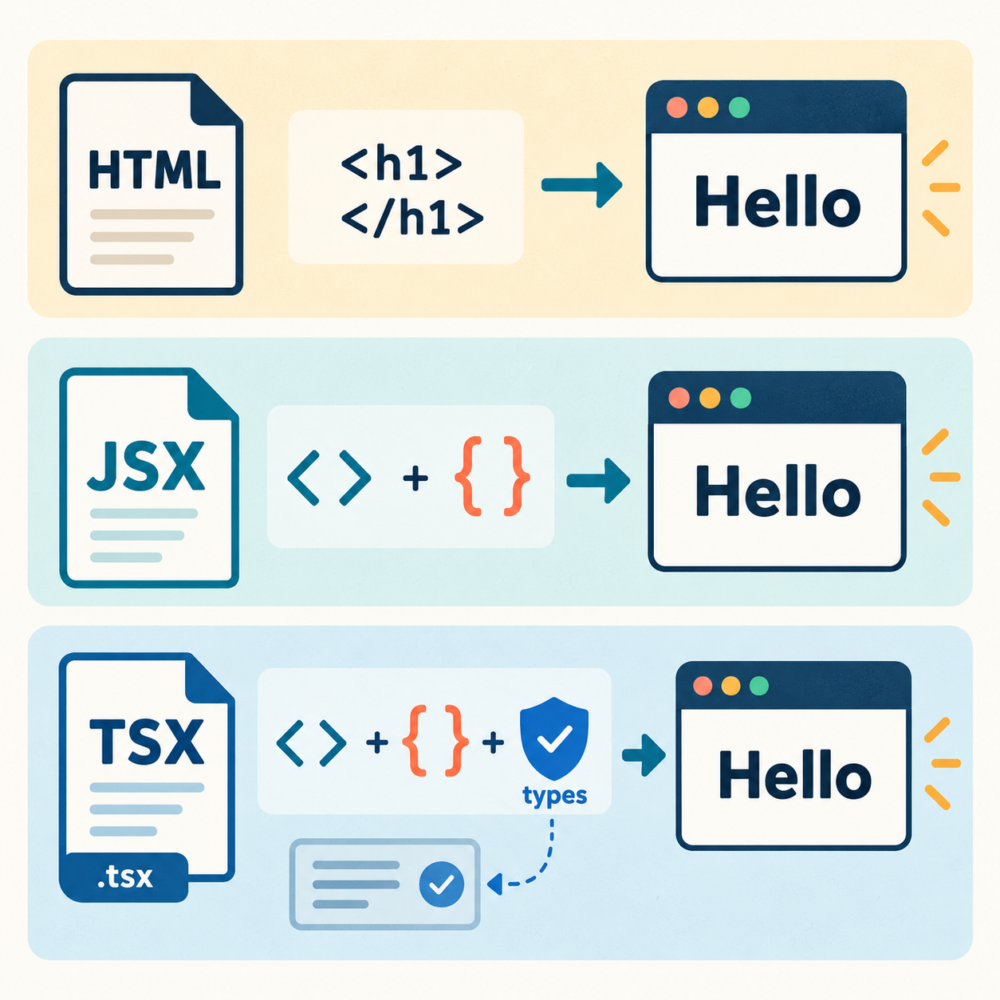
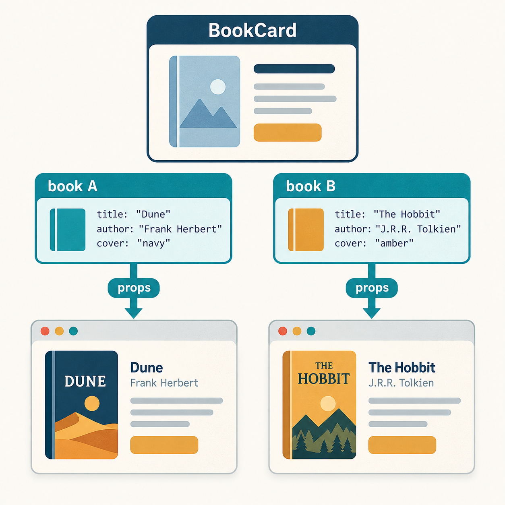
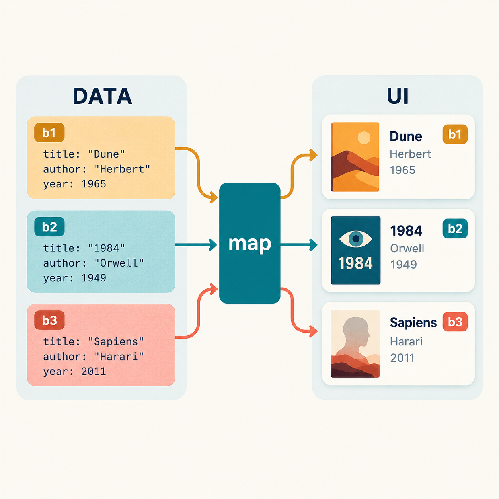
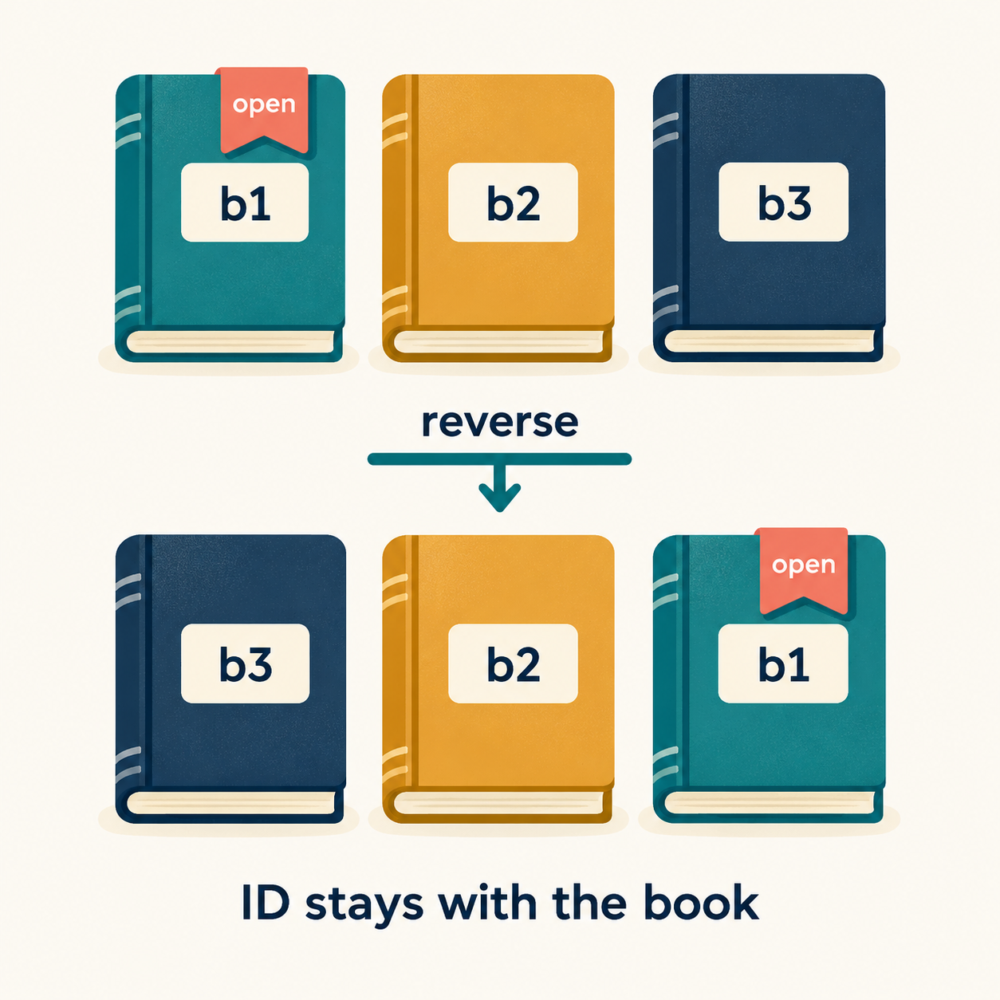

# Lab 06 — React components: จาก JSX/TSX สู่ Book Explorer

React เป็นไลบรารีสำหรับสร้าง UI จาก **components**: ส่วนของหน้าจอที่มีชื่อ มีหน้าที่ชัดเจน และนำกลับมาใช้ได้ เราจะสร้าง BookCard หนึ่งแบบ ใช้กับหนังสือหลายเล่ม แล้วเพิ่มการค้นหาที่เปลี่ยนหน้าจอตาม state

## เป้าหมายและหนังสือที่ใช้คู่กัน

เมื่อจบ lab คุณควรสร้าง component, ส่ง props, แสดง array, จัดการ state และอธิบายเส้นทางข้อมูลด้วยโค้ดของตนเองได้

อ่านหนังสือ **DTI201 Full Stack Chapter 5** ตามตาราง เลขหน้าเป็นหน้าที่พิมพ์ในฉบับที่ตรวจ ไม่ใช่เลขหน้าในโปรแกรม PDF หากฉบับต่างกันให้ตามเลขหัวข้อ

| หัวข้อ | หน้าที่พิมพ์ | สิ่งที่จะเขียนข้างหนังสือ |
|---|---:|---|
| §5.3 Vite | 79 | folder → server → browser |
| §5.4 JSX | 79–80 | JSX + TypeScript → TSX |
| §5.5 Components / props | 80–81 | DrinkCard ↔ BookCard; inputs ของแต่ละ component |
| §5.6 State / snapshot | 81–83 | ค่าใน render นี้ กับการขอ render ถัดไป |
| §5.6.1 Derived data | 83 | ข้อมูลใดคำนวณได้ ไม่ต้องเก็บซ้ำ |
| §5.7 State ownership | 83–84 | เจ้าของ query และลูกศร callback |
| §5.8 Stable keys | 84 | ตัวตนของข้อมูลเทียบกับตำแหน่ง |
| §5.9–5.11 | 84–87 | routing และโครงสร้าง frontend สำหรับงานต่อยอด |

เตรียม editor, browser, Node.js 24 และ npm หากยังไม่มีให้ติดตั้งจาก [Node.js](https://nodejs.org/en/download) ทบทวน HTML, function, object, array และ JSON จาก lab ก่อนหน้า การทดลองนี้ใช้ข้อมูลในเครื่อง ไม่ต้องเปิด API server

## ก่อนเขียน: JSX และ TSX คืออะไร?



- **JavaScript** คำนวณค่าและจัดการเหตุการณ์
- **JSX** เป็น syntax extension ที่เขียน markup ใน JavaScript; `{expression}` แทรกค่าที่คำนวณได้
- **TypeScript** เพิ่มการตรวจชนิดข้อมูล เช่น `string`, `number`, `boolean` ก่อนรัน
- **TSX** คือไฟล์ TypeScript ที่มี JSX ใช้นามสกุล `.tsx`; ไฟล์ type/data ไม่มี JSX ใช้ `.ts`

```tsx
const title: string = 'My library';
const heading = <h1>{title}</h1>;
```

`const` ประกาศตัวแปรที่ไม่กำหนดค่าใหม่; `: string` ระบุชนิดข้อความ เครื่องมือ build แปลง JSX เป็น JavaScript และลบ type ก่อนใช้งาน TypeScript ไม่ได้ตรวจข้อมูลจาก API ขณะรันให้อัตโนมัติ

กติกา JSX: คืน parent หนึ่งตัวหรือ fragment `<>...</>`, ปิดทุก tag (`<input />`), ใช้ `className` สำหรับ CSS class ชื่อ component ต้องขึ้นต้นตัวใหญ่ เช่น `<BookCard />`; tag ตัวเล็ก เช่น `<article>` เป็น HTML element

## Activity 0 — สร้างโฟลเดอร์และเปิดแอป (10–15 นาที)

เลือก **หนึ่งทาง** แล้วทำขั้นตรวจผลร่วมกัน

### ทาง A: สร้างด้วย Vite ให้ตรงกับสไลด์

เปิด terminal ในโฟลเดอร์ที่ต้องการเก็บงาน แล้วรันทีละบรรทัด:

```bash
node --version
npm --version
mkdir react-foundations-lab
cd react-foundations-lab
npm create vite@latest . -- --template react-ts
npm install
npm run dev
```

`mkdir` สร้างโฟลเดอร์; `cd` เข้าโฟลเดอร์นั้น; `.` หมายถึงโฟลเดอร์ปัจจุบัน Vite สร้างโครงโปรเจกต์ React + TypeScript; `npm install` ติดตั้ง dependencies; `npm run dev` เปิด development server หาก npm ขอให้ติดตั้ง create-vite ให้ยืนยัน

### ทาง B: clone โครงตั้งต้นของชั้นเรียน

สำหรับผู้ที่ยังไม่มีสำเนา repository นี้:

```bash
git clone https://github.com/3-courses/dti201-fullstack-inclass-labs-1-2569.git
cd dti201-fullstack-inclass-labs-1-2569/examples/06-react-foundations
npm ci
npm run dev
```

ถ้ามีสำเนาแล้ว ให้เปิด `examples/06-react-foundations` ในสำเนานั้น `npm ci` ติดตั้งตาม lockfile ของตัวอย่าง เก็บงานใน repository ส่วนตัว ไม่ส่งงานนักศึกษาขึ้น repository กลาง

### ตรวจผลร่วมกัน

1. เปิด URL ที่ terminal แสดง เช่น `http://localhost:5173` (port อาจต่างกัน)
2. เปิดโฟลเดอร์ใน editor: `package.json` เก็บ dependencies/scripts, `index.html` มี root ของแอป, `src/main.tsx` เริ่ม React และแสดง `<App />`
3. แก้เฉพาะ `src/App.tsx` ตาม Activity 1 ก่อน; ใช้ `main.tsx` จาก template
4. ให้ terminal ทำงานไว้ระหว่างฝึก หยุด server ด้วย **Ctrl+C** เมื่อเสร็จ

**หลักฐาน:** บันทึก Node version และ URL ที่เปิดได้; วาด folder → server → browser ข้าง §5.3

## Activity 1 — อ่านและแก้ JSX (5 นาที)

`function` ประกาศฟังก์ชัน; `return` คืนผลลัพธ์; `export default` ส่ง component หลักของไฟล์ให้ไฟล์อื่น import React เรียก component เพื่อคำนวณ UI

แทนที่ `src/App.tsx` ทั้งไฟล์ด้วย:

```tsx
export default function App() {
  const title = 'My library';
  const total = 5;
  return (
    <main>
      <h1>{title}</h1>
      <p>Books: {total}</p>
    </main>
  );
}
```

**ทำ:** เปลี่ยน title เป็นชื่อชั้นหนังสือของคุณ ตั้ง total เป็น 8 แล้วใช้ `{total + 1}` เพิ่ม paragraph ที่บอกชื่อเจ้าของ

**ตรวจ:** ทำนายตัวเลขก่อนบันทึกไฟล์ แล้วเทียบหน้าจอ ชี้ข้อความคงที่กับ expression ให้เพื่อนดู การบันทึก source ทำให้เครื่องมือโหลดโค้ดใหม่ ยังไม่ใช่การอัปเดต state จากปุ่ม

**เขียนในหนังสือ:** §5.4 “JSX ใช้ `{ }` เพื่อ…”; เริ่ม knowledge map `React → component → JSX → UI` พร้อมคำกริยาบนเส้น

## Activity 2 — Component เดียว ข้อมูลสองชุด (10 นาที)



**Object** เก็บคู่ชื่อ/ค่า; `book.title` อ่าน property; **props** คือ inputs จาก parent ให้ลูก ส่วน **type** ตั้งชื่อรูปแบบข้อมูล

สร้าง `src/types.ts` (ทาง B มีแล้ว):

```ts
export type Book = {
  id: string;
  title: string;
  author: string;
};
```

นี่คือ type แบบย่อสำหรับฝึก เมื่อย้ายข้อมูลจริงจาก lab เดิม ให้คง field `topic`, `sourceType`, `summary` ที่ใช้ในงานไว้

สร้าง `src/data/books.ts` (สร้างโฟลเดอร์ `data` ด้วย):

```ts
import type { Book } from '../types';

export const books: Book[] = [
  { id: 'b1', title: 'Learning React', author: 'Alex' },
  { id: 'b2', title: 'Web Basics', author: 'Sam' },
  { id: 'b3', title: 'JavaScript Lab', author: 'Nok' },
  { id: 'b4', title: 'React Components', author: 'Lee' },
  { id: 'b5', title: 'CSS Practice', author: 'Nok' },
];
```

ข้อมูลนี้เป็นข้อมูลสมมติ `Book[]` คือ array ของ Book; `import type` นำเข้าเฉพาะ type; `export const` ส่งออกค่าที่มีชื่อ

ใน `App.tsx` นำเข้า type และข้อมูลไว้บนสุด:

```tsx
import type { Book } from './types';
import { books } from './data/books';
```

เพิ่ม component นี้นอก App (เช่น ก่อนประกาศ App):

```tsx
type BookCardProps = { book: Book };

function BookCard(props: BookCardProps) {
  return (
    <article>
      <h2>{props.book.title}</h2>
      <p>{props.book.author}</p>
    </article>
  );
}
```

**ทำ:** ใน return ของ App ใช้ `<BookCard book={books[0]} />` และอีกใบจาก `books[1]` โดยครอบด้วย `<main>` ตัวเดียว Array เริ่มนับ index ที่ 0

**ตรวจ:** เปลี่ยนผู้แต่งหนึ่งเล่ม จากนั้นเปลี่ยน JSX ของ BookCard สังเกตว่าสิ่งใดเปลี่ยนทุกใบและสิ่งใดเปลี่ยนเฉพาะใบ Props เป็นข้อมูลอ่านอย่างเดียวสำหรับลูก

**อ่านรูปแบบย่อ:** `function BookCard({ book }: BookCardProps)` แยก property book มาเป็นตัวแปร เรียกว่า **destructuring** จึงใช้ `book.title` แทน `props.book.title` ได้

**เขียนในหนังสือ:** §5.5 เทียบ DrinkCard กับ BookCard และระบุผู้ส่ง/ผู้รับ props

## Activity 3 — Array → map → list และ empty state (10 นาที)



**Arrow function** เป็นรูปแบบย่อ: `n => n * 2` รับ n แล้วคืนผลคูณ **Callback** คือฟังก์ชันที่ส่งให้โค้ดอื่นเรียก `map` เรียก callback กับแต่ละรายการแล้วสร้าง array ของผลลัพธ์ เช่น `[1, 2].map(n => n * 2)` ได้ `[2, 4]` ถ้าใช้ body `{ }` ต้องเขียน `return`

**ทำ:** เพิ่ม `BookList` นอก App ให้รับ `{ books: Book[] }` แล้วใช้โครงนี้ภายใน JSX ของ BookList:

```tsx
{books.map(book => (
  <BookCard key={book.id} book={book} />
))}
```

ให้ App แสดง `<BookList books={books} />` แทนการเขียน BookCard ทีละใบ

`key` ช่วย React จับคู่รายการระหว่าง render ใช้ id ที่คงที่และไม่ซ้ำในกลุ่มพี่น้อง ลูกอ่าน `props.key` ไม่ได้ ถ้าต้องการ id ให้อ่าน `book.id`

**Empty state:** `books.length` คือจำนวนรายการ; `===` เปรียบเทียบ; `if` เลือกทำเมื่อจริง เพิ่มเงื่อนไขก่อน return รายการ: ถ้า length เป็น 0 ให้คืน `<p role="status">No books found.</p>` โดย role ระบุข้อความสถานะให้เทคโนโลยีช่วยอ่าน

**ตรวจ:** 5 รายการแสดง 5 ใบ → เพิ่มรายการที่ 6 โดยไม่เพิ่ม JSX → ส่ง `[]` แล้วเห็น empty state → คืนข้อมูลตั้งต้น 5 รายการก่อนทำ search

**เขียนในหนังสือ:** §5.5 และ §5.8 เติม `array → map → elements` และอธิบาย key หนึ่งประโยค

## Activity 4 — Event และ state ของสอง instances (8 นาที)

**Event handler** คือฟังก์ชันที่เรียกเมื่อเกิดเหตุการณ์ เช่น click ส่งฟังก์ชันให้ onClick ไม่เรียกทันทีระหว่าง render: ใช้ `onClick={handleClick}` ไม่ใช่ `onClick={handleClick()}`

**State** คือข้อมูลที่ component จำข้าม render; **Hook** เช่น useState เพิ่มความสามารถให้ component เรียก Hook ระดับบนสุดของ component ไม่เรียกใน if หรือ loop

เพิ่ม import ไว้บนสุดของ App.tsx และเพิ่ม Counter นอก App:

```tsx
import { useState } from 'react';

function Counter() {
  const [count, setCount] = useState(0);
  return (
    <button onClick={() => setCount(c => c + 1)}>
      Clicks: {count}
    </button>
  );
}
```

`[count, setCount]` คือ array destructuring รับค่าปัจจุบันและ setter; 0 คือค่าเริ่มต้น `() => ...` เป็น handler ไม่มี parameter; `c => c + 1` รับค่าที่รออัปเดตแล้วคืนค่าถัดไป

**ทำ/ตรวจ:** แสดง Counter สองตัวใน App กดตัวแรกสามครั้ง จดค่าของทั้งสองตัวและอธิบายว่า state เป็นของ instance ใด จากนั้นคืน App ไปเป็น Book Explorer

**เขียนในหนังสือ:** §5.6 เติม `event → setter → render → UI` พร้อมผลทดลอง

## Activity 5 — ทำนาย snapshot กับ updater (8 นาที)

ค่าของ state ที่ handler อ่านเป็น **snapshot** ของ render นั้น Setter ขอให้อัปเดตครั้งถัดไป ไม่ได้เปลี่ยนตัวแปรใน handler ปัจจุบันทันที

เปิด [snapshot experiment](../examples/06-react-foundations/experiments/snapshot-experiment/App.tsx) เก็บสำเนา App.tsx ของคุณ แล้วใช้ไฟล์ทดลองแทนชั่วคราว (ทาง A คัดลอกจากลิงก์ได้)

**ทำ:** เริ่มจาก 0 ทุกครั้ง เปรียบเทียบ `setCount(count + 1)` สองครั้งใน handler เดียว กับ `setCount(c => c + 1)` สองครั้ง ทำนายก่อนกดปุ่มแล้วจดผลจริง ใช้ Reset ก่อนแต่ละรอบ

**ตรวจ:** อธิบายโดยไล่ค่า snapshot และค่าที่ส่งต่อใน updater queue ห้ามตอบเพียงว่า “React ช้า”

**เขียนในหนังสือ:** §5.6 เขียนว่ารูปแบบใดรับค่าที่รออัปเดต; คืน App.tsx ของ Book Explorer เมื่อเสร็จ

## Activity 6 — วาดเจ้าของ state ก่อนเขียน search (5 นาที)

วาด tree นี้ในสมุดหรือข้าง §5.7:

```text
App
  BookPage
    BookFilters
    BookList
      BookCard (หลาย instances)
```

**ทำ:** ตัดสินใจว่า query ควรอยู่ที่ใด เมื่อ BookFilters ต้องแสดงค่าที่พิมพ์ และ BookList ต้องแสดงผลจาก query เดียวกัน วาดลูกศรค่าที่ส่งลง และลูกศรการเรียก callback เพื่อขอเปลี่ยนค่า

**ตรวจ:** อธิบายว่าทำไมไม่เก็บ query สองชุดในลูกสองตัว

หลังวาดแล้วจึงเทียบกับ [ภาพเส้นทางข้อมูล](../assets/lab06-react/state-owner.png) ภาพใช้ข้อมูลต่างจาก lab; ให้ดูความสัมพันธ์ระหว่าง component

## Activity 7 — Controlled input และ derived search (15 นาที)

**Controlled input** แสดงค่าจาก state ผ่าน value; onChange รับ event เมื่อพิมพ์ อ่าน `event.target.value` แล้วเรียก callback จาก parent

ชนิด callback นี้หมายถึงรับข้อความและผู้เรียกไม่ใช้ค่าที่คืน (`void`):

```ts
type FilterProps = {
  query: string;
  onQueryChange: (value: string) => void;
};
```

**ทำ:** เขียน BookFilters ที่รับ props ตาม type นี้ ใช้ `<label>` ครอบข้อความ “Search books” และ input:

```tsx
<input
  value={query}
  onChange={event => onQueryChange(event.target.value)}
/>
```

สร้าง BookPage รับ books และเก็บ query ด้วย `useState('')` ส่ง query และ setter ให้ BookFilters

อ่านเครื่องมือก่อนกรองข้อมูล:

- `filter(callback)` สร้าง array ใหม่จากรายการที่ callback คืน true
- `toLowerCase()` เปลี่ยนเป็นตัวเล็ก; `trim()` ตัดช่องว่างหัวท้าย
- `includes(text)` ตรวจว่ามีข้อความย่อยหรือไม่; ทุกข้อความมี empty string อยู่ภายใน
- **Derived data** คำนวณจากข้อมูลปัจจุบันได้ ไม่ต้องมี state อีกชุด

**ทำต่อ:** คำนวณ visibleBooks ด้วย filter ของ title โดยไม่สนตัวพิมพ์และช่องว่างหัวท้าย ส่งให้ BookList และแสดงจำนวนจาก `visibleBooks.length` ให้ App แสดง BookPage พร้อมส่ง books ตั้งต้น

**ตรวจด้วยข้อมูล 5 รายการเดิม:**

| คำค้น | ผลที่ต้องเห็น |
|---|---|
| ว่าง | 5 รายการ |
| `React` | 2 รายการ |
| ` react ` | 2 รายการ |
| `zzzz` | 0 รายการและ empty state |

**เขียนในหนังสือ:** §5.6.1 และ §5.7 ไล่ “พิมพ์ → callback → setter → render → filter → list” ระบุบรรทัดโค้ดที่เป็นหลักฐานแต่ละช่วง

## Activity 8 — ค้นหาผู้แต่งโดยไม่เพิ่ม state (8 นาที)

`||` คือ logical OR: ถ้าเงื่อนไขใดเงื่อนไขหนึ่งเป็นจริง ผลเป็นจริง

**ทำ:** ขยาย filter ให้ค้นพบเมื่อ title **หรือ** author ตรงกับคำค้น โดยใช้ query เดิม

**ตรวจ:** `Nok` พบ 2 รายการ, `React` ยังพบ 2 รายการ, คำค้นว่างพบครบ 5 รายการ

**เขียนในหนังสือ:** §5.6.1 อธิบายเหตุใด visibleBooks และจำนวนผลลัพธ์ไม่ต้องมี setter ของตนเอง

## Activity 9 — Stable key รักษาตัวตนเมื่อเรียงใหม่ (10 นาที)



**Immutable update** สร้างค่าใหม่แทนการแก้ array ใน state โดยตรง `[...items]` ใช้ spread คัดลอก array แบบตื้น; reverse แก้ array ที่เรียกมัน จึงต้อง copy ก่อน เช่น `[...items].reverse()`

เก็บสำเนางานแล้วใช้ [key experiment](../examples/06-react-foundations/experiments/key-experiment/App.tsx) แทน App.tsx ชั่วคราว ในตัวอย่าง `condition ? a : b` เลือก a เมื่อจริง มิฉะนั้นเลือก b; `{open && <p>...</p>}` แสดง paragraph เมื่อ open เป็นจริง

**ทำ:**

1. ใช้ `USE_INDEX_KEYS = false` แล้ว reload; เปิดเล่มแรกและกด Reverse
2. บันทึกว่า state “เปิดอยู่” ติดกับเล่มเดิมหรือไม่
3. เปลี่ยนเป็น true แล้ว reload เริ่มใหม่ ทำเหมือนเดิม
4. อธิบายผลด้วยตัวตนของข้อมูลเทียบกับตำแหน่ง; คืน App.tsx ของคุณเมื่อเสร็จ

**เขียนในหนังสือ:** §5.8 วาดก่อน/หลัง reverse พร้อม id; อธิบายว่าปัญหานี้มากกว่าการปิด warning อย่างไร

## Activity 10 — Knowledge map และพิสูจน์ความเข้าใจ (10 นาที)

เชื่อม React, component, JSX, TSX, props, state, event, derived data และ key โดย **ใส่คำกริยาบนเส้น** ทุกเส้น เพิ่มเลขหัวข้อหนังสือและตัวอย่างโค้ดของตนเอง

ใช้แผนที่ตอบ “พิมพ์ Nok” และ “reverse รายการที่มี state ของแต่ละเล่ม” ให้เพื่อนชี้จุดที่ยังอธิบายไม่ได้แล้วแก้แผนที่

**โจทย์สุดท้าย:** เพิ่มปุ่ม Clear search ให้ช่องค้นหาว่างและกลับมาเห็นครบ 5 เล่ม โดยเปลี่ยน state ต้นทางเพียงจุดเดียว เพิ่ม CSS ให้ใช้ได้ทั้งมือถือและ desktop

เปิด terminal อีกหน้าต่างใน root โปรเจกต์:

```bash
npm run build
```

คำสั่งนี้ตรวจ TypeScript และสร้าง production bundle ใน dist ต้องแก้ error ให้ผ่านก่อนส่งหลักฐาน

## หลักฐานที่ส่งในพื้นที่งานส่วนตัว

- ภาพแอปเมื่อพบ 2 รายการและเมื่อไม่พบรายการ พร้อมผลตรวจจากตาราง
- component tree ที่ระบุเจ้าของ query และเส้นทาง callback
- โค้ดที่มี type Book, props, list/empty state, stable id key และ search
- ผล snapshot และ key experiments พร้อมคำอธิบายของตนเอง
- knowledge map ที่อ้าง §5.4–5.8 และมีตัวอย่างโค้ด
- ผล `npm run build` ผ่าน และ commit ใน repository งานของตนเอง

คำถามอธิบายงาน: JSX ต่างจาก TSX อย่างไร? Props ต่างจาก state อย่างไร? ทำไม query อยู่ที่ component นี้? ทำไมไม่เก็บผล filter เป็น state? index key เสี่ยงเมื่อใด?

## เมื่อมีปัญหา

| อาการ | ตรวจจากอะไร |
|---|---|
| npm ใช้ไม่ได้ / Node ไม่รองรับ | `node --version`, `npm --version`; ใช้ Node.js 24 |
| หา package.json ไม่เจอ | terminal อยู่ใน root โปรเจกต์หรือไม่ |
| JSX parse error | ไฟล์เป็น `.tsx`, tag ปิดครบ, มี parent เดียว |
| import ไม่พบ | ชื่อไฟล์, ตัวพิมพ์เล็กใหญ่, path และ named/default export |
| พิมพ์ใน input ไม่ได้ | value มี onChange ที่เรียก setter หรือไม่ |
| เปลี่ยนตัวแปรแต่ UI ไม่เปลี่ยน | ใช้ state และ setter หรือไม่ |
| state ไปติดกับเล่มอื่นหลัง reorder | ใช้ stable id เป็น key หรือไม่ |

หยุด dev server ด้วย Ctrl+C หลังเสร็จ

## งานต่อยอดและขอบเขต

เมื่ออธิบาย function components และ props ได้แล้ว จึงแยกไฟล์ตามหน้าที่และต่อ routing ตาม §5.9–5.11 ส่วน forms, effects และ API service ต่อใน Lab 07

บท “Creating Class” ช่วยเรื่องแบ่งหน้าที่และ reuse แต่ lab นี้ใช้ **function components** ก่อน Classes ยังรองรับสำหรับอ่านโค้ดเดิม; React แนะนำ functions สำหรับโค้ดใหม่ ดู [Component API](https://react.dev/reference/react/Component) Generic table ควรรอจนจัดการ props, arrays และ empty state ได้คล่อง

อ้างอิง: [JSX](https://react.dev/learn/writing-markup-with-jsx), [TypeScript](https://react.dev/learn/typescript), [Vite](https://vite.dev/guide/), [State snapshot](https://react.dev/learn/state-as-a-snapshot), [Lists](https://react.dev/learn/rendering-lists)
