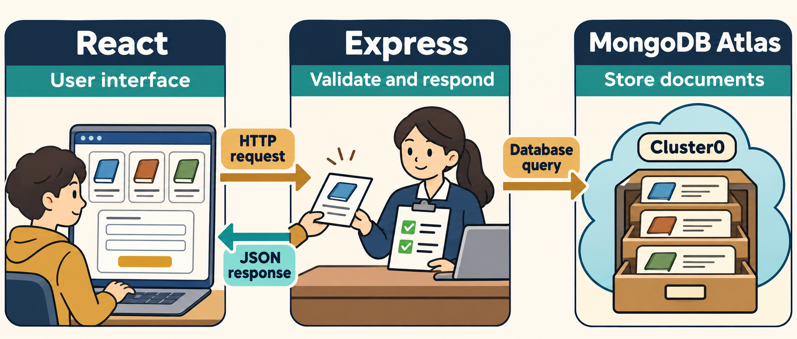
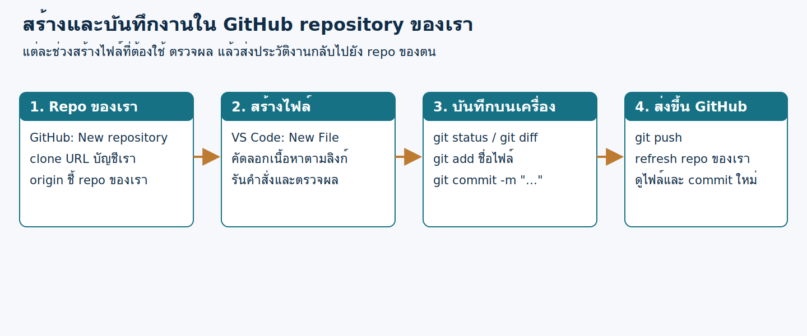
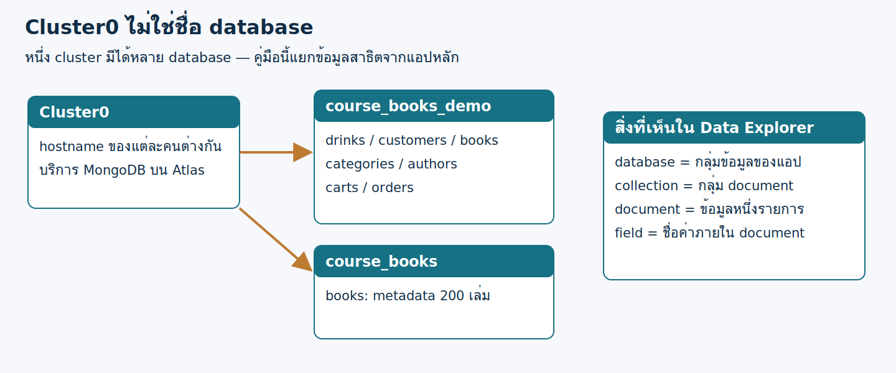

# Lab 10 — สร้าง repo ของเรา แล้วเชื่อมแอปหนังสือกับ MongoDB Atlas

เมื่อกรอกหนังสือผ่านหน้าเว็บ ข้อมูลต้องยังอยู่หลังปิดและเปิด Express ใหม่ เราจะสร้างโปรเจกต์ใน GitHub repository ของตนเอง ตั้งแต่ README และ .gitignore จนมี backend, frontend และประวัติ commit ของแต่ละช่วง



**React** แสดงรายการและรับข้อมูลจากฟอร์ม **Express** รับ HTTP request ตรวจข้อมูล และเรียกฐานข้อมูล ส่วน **MongoDB** เก็บ document หนังสือไว้บน Atlas หน้าเว็บส่งคำขอไป Express และได้รับ JSON กลับมา ไม่เชื่อม Atlas โดยตรง

## เริ่มจาก GitHub repo ของตนเอง

เปิด repo แลบนี้ใน browser เพื่ออ่านคำอธิบายและคัดลอกเนื้อหาไฟล์ตามลิงก์ ส่วนการสร้างไฟล์ รันคำสั่ง และ commit ทำใน repo `dti201-bookstore` ของเรา



| ลำดับ | เปิดคู่มือ | สิ่งที่ลงมือทำ | ผลที่ควรเห็น |
|---|---|---|---|
| 0 | [สร้าง GitHub repo และ clone ลงเครื่อง](../docs/lab10/00-create-your-repository.md) | สร้าง README/.gitignore ตรวจ origin แล้ว commit/push | repo ของเรามี commit แรกจากเครื่อง |
| 1 | [สร้าง backend ต่อ Atlas และดูข้อมูลตัวอย่าง](../docs/lab10/01-atlas-and-sample.md) | npm init ติดตั้งแพ็กเกจ สร้างไฟล์ connection/.env/demo | ping ผ่านและเห็น sample DB ใน Atlas |
| 2 | [สร้าง model และ query เครื่องดื่ม](../docs/lab10/02-drinks-walkthrough.md) | สร้าง Drink.js และ drinks.js แล้วติดตามผล query | JSON ตรงกับเครื่องดื่มสองรายการใน Atlas |
| 3 | [อ่าน ER ร้านหนังสือทั้งสามภาพ](../docs/lab10-book-data-model.md) | ติดตาม ID และรายการที่ฝังใน document | เห็นว่าลูกค้า ตะกร้า และคำสั่งซื้อเชื่อมกันอย่างไร |
| 4 | [สร้าง Book model, seed และ API](../docs/lab10/03-book-api-walkthrough.md) | สร้างไฟล์ทีละส่วน ทดลอง GET/POST/PATCH/DELETE แล้ว commit | API อ่านและเปลี่ยนข้อมูลใน MongoDB |
| 5 | [สร้าง frontend และต่อ API](../docs/lab10/04-react-and-checks.md) | npm init สร้างไฟล์ React แล้วเพิ่ม/แก้/ลบผ่านฟอร์ม | หน้าเว็บกับ Atlas แสดงข้อมูลเดียวกัน |

แต่ละช่วงใช้เวลาต่อได้หลายคาบ ถ้าหยุดพัก ให้เก็บไฟล์ .env บนเครื่องไว้ และเริ่มต่อจาก commit ของเรา ไม่ต้องลบฐานข้อมูลหรือสร้าง repo ใหม่

## โฟลเดอร์งานของเราเมื่อทำถึงช่วงสุดท้าย

```text
dti201-bookstore/
├── README.md
├── .gitignore
├── backend/
│   ├── package.json
│   ├── package-lock.json
│   ├── .env.example
│   ├── .env                ค่าจริงบนเครื่อง ไม่อยู่ใน Git
│   ├── src/
│   │   ├── db.js
│   │   ├── models/Book.js
│   │   ├── books.js
│   │   ├── book-store.js
│   │   ├── app.js
│   │   └── server.js
│   ├── scripts/
│   └── demo/
└── frontend/
    ├── package.json
    ├── package-lock.json
    ├── index.html
    ├── vite.config.js
    └── src/
```

ไม่ต้องสร้างทุกไฟล์จากภาพนี้ทันที แต่ละช่วงจะระบุไฟล์ที่ต้องสร้างก่อนรัน พร้อมลิงก์เนื้อหาจาก GitHub แลบและตำแหน่งปลายทางใน repo เรา ตัวอย่างเช่น `examples/10-mongodb-book-api/src/db.js` บนเว็บ จะวางใน `backend/src/db.js` ของเรา

เริ่มที่ [ช่วง 0 — สร้าง repo ของเรา](../docs/lab10/00-create-your-repository.md)

## ฐานข้อมูลสองชุดบน Cluster0



- **course_books_demo**: ตัวอย่างเครื่องดื่มและร้านหนังสือชุดเล็ก ใช้เปิดดู reference, embedded items และราคาตอนซื้อ
- **course_books**: metadata หนังสือ 200 เล่มตั้งต้น ใช้กับ Book API และ React

ชื่อ books มีในทั้งสองฐาน แต่หน้าที่ต่างกัน ฐาน demo มี SKU/ราคา/รหัสผู้เขียน ส่วนฐานหลักเก็บ title/author/sourceType/summary เพื่อแสดงรายการและสรุปแหล่งอ่าน ข้อมูลลูกค้าใน demo เป็นข้อมูลสมมติ ไม่มีการรับเงินจากหน้าเว็บนี้

## ทางเลือก Docker สำหรับรัน MongoDB บนเครื่อง

ใช้ Atlas เป็นเส้นทางหลัก หากต้องการใช้ MongoDB บนเครื่องแทน ให้ทำหลังสร้าง backend และ .env ในช่วง 1 แล้ว ข้อมูล Docker กับ Atlas เป็นคนละชุด

1. เปิด Docker Desktop หรือ Docker Engine
2. ที่ terminal `dti201-bookstore/backend` ตรวจว่า docker info และ docker compose version ทำงานได้
3. ใน VS Code สร้าง `backend/compose.yaml` คัดลอกเนื้อหาจาก [compose.yaml](../examples/10-mongodb-book-api/compose.yaml) บนเว็บแลบแล้ว Save
4. เพิ่มคำสั่งที่ backend:

```bash
npm pkg set 'scripts.db:up=docker compose up -d --wait --wait-timeout 120 db'
npm pkg set 'scripts.db:stop=docker compose stop db'
```

5. แก้ backend/.env ให้เหลือ URI ที่ใช้งานเพียงบรรทัดเดียว:

```dotenv
MONGODB_URI=mongodb://127.0.0.1:27018/course_books
PORT=3001
MONGO_PORT=27018
```

6. รันจาก backend:

```bash
docker compose config --quiet
npm run db:up
docker compose ps
npm run db:check
```

config สำเร็จจะไม่พิมพ์อะไร db:up รอ healthcheck ก่อนคืนคำสั่ง ps ต้องเห็น healthy และ db:check ต้องได้ Database ping: OK จึงทำ demo:seed หรือ seed ตามช่วงถัดไป

ถ้าเปิดไม่ได้ ให้ดู `docker compose logs --tail=60 db` หาก port 27018 ถูกใช้ เปลี่ยนทั้ง MONGO_PORT และ port ใน URI เป็น 27019 แล้วรัน db:up ใหม่ ไม่หยุด container ของงานอื่น

Express รันบนเครื่องและเรียก `127.0.0.1:27018` ที่ส่งต่อไป port 27017 ใน container ไม่ใช้ `db:27017` เพราะ Express ไม่ได้อยู่ใน Compose network

ดูข้อมูลแทน Atlas Data Explorer ได้ด้วย:

```bash
docker compose exec db mongosh course_books_demo --eval 'db.drinks.find().toArray()'
docker compose exec db mongosh course_books --eval 'db.books.countDocuments()'
```

หยุด DB ด้วย npm run db:stop ไม่ใช้ down -v เพราะลบ volume หลังตรวจแล้ว commit เฉพาะ compose.yaml และ package.json ไม่ commit .env
